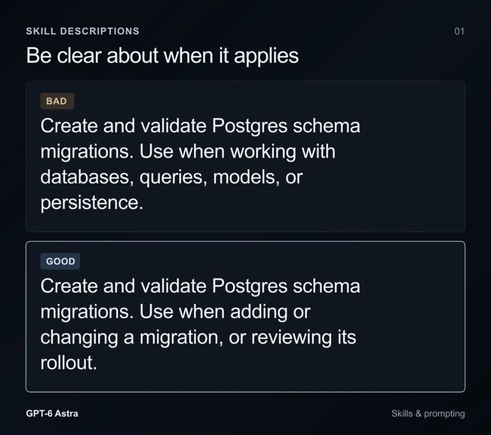
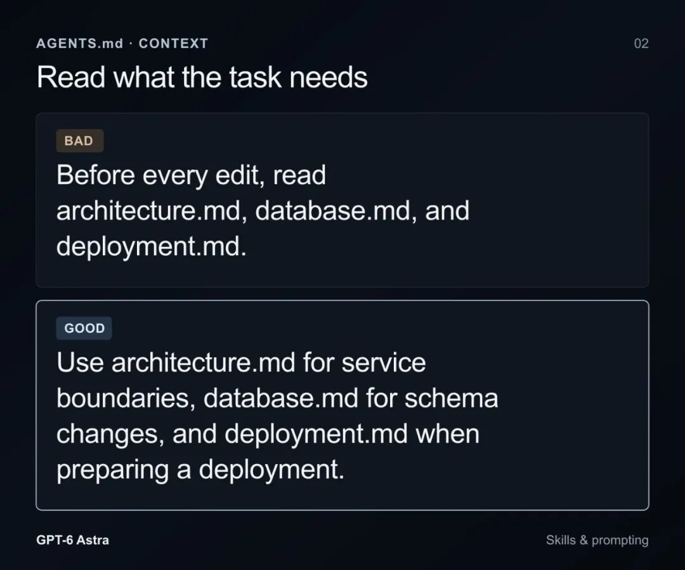

# 📰 重磅！OpenAI 官方 Prompt 指南升级

 Datawhale干货 

### 作**者：Eric Provencher，OpenAI团队

==========

为了让 AI 少犯错，我们往提示词里加了不少规矩：改代码前先读完架构文档，写完一定要跑测试，没有明确允许就不能碰其他文件。模型哪里不够可靠，就再补一条。

但模型换代之后，这些规矩还都有用吗？

OpenAI Codex 团队工程师 Eric Provencher 近期在一篇提示词教程中，讨论了 GPT-6 系列模型的指令设计。此前，他已写过面向 GPT-5.6 的 Prompt 指南，这次则进一步聚焦新模型下 Skill、AGENTS.md 和任务指令的调整。

他提醒开发者：过去一年积累的 Skill、AGENTS.md 和任务提示词，有些已经不再适用，甚至开始帮倒忙。模型的推理和代码理解能力增强了，旧指令却还在要求它按原来的步骤做事。结果可能是响应更慢、上下文更拥挤，解决问题的路径也被限制住了。

Anthropic 在同期发布的 Claude Fable 5.1 官方提示词指南中，也提到了类似现象：为旧模型准备的约束，放到新模型上，可能变成过度约束。

这意味着，换模型时，除了看能力提升了多少，还要检查一件事：项目里那些用来弥补旧模型短板的指令，哪些可以删了？

## 一、Skill 装得越多，模型就越会用吗？

Skill 通常是一份 Markdown 格式的专项提示词，有时还带着脚本。它告诉模型，遇到某类任务时，该怎样执行工作流、调用工具。

听起来，多装几个 Skill，模型就能多会几样事情。但在它真正打开某个 Skill 之前，还有一步：先判断该用哪一个。

为此，Skill 的名称和功能描述会常驻在系统上下文中，供模型检索和匹配。单个描述太长，或者安装的 Skill 太多，都会占用这部分空间。按 Eric 的说明，Codex 这类系统可能会截断描述，以适应上下文长度。描述不完整，模型就更难判断一个工具能做什么、什么时候该用。

还有些描述写得过于宽泛，几乎什么任务都想接。比如，一个用于数据库迁移的 Skill，把触发条件写成了“只要涉及数据库操作就调用”。你只是想改一个查询字段，模型却可能加载整套迁移流程。

所以，精简 Skill，要先从描述开始。写清它处理什么任务，尤其是什么时候才需要它。数据库迁移，就把触发范围限定在 migration 上。具体怎么执行，留到模型选中它之后再读。

Skill 内部也可以沿着这个思路组织。根文档保留必要的指引，告诉模型去哪里找细节；复杂步骤和脚本放在子文档中，等任务需要时再加载。这就是渐进式展开（Progressive Disclosure）。

这样，模型处理一个局部问题时，就不用先读完一整套操作手册，能把更多上下文留给当前代码和问题本身。

除了文件怎么组织，里面的步骤也值得重新看一遍。早期模型理解复杂任务不够稳定，把每一步写清楚，确实能提高交付的稳定性。按 Eric 对 GPT-6 Astra 的观察，它对歧义、语义细节和工程语境的理解已经增强。继续要求它严格执行固定步骤，有时会限制它根据项目情况选择更合适的做法。

多人协作的仓库还要考虑模型差异。同一份 Skill，可能同时被 Sol、Luna 和 Astra 使用。为某个模型补短板的规则，放到另一个模型上，未必还有同样的效果。

## 二、只改一个变量，也要先读完整个仓库？

相比按需加载的 Skill，AGENTS.md 更值得逐条检查。它是仓库级的全局规则，会在模型与仓库交互的每一轮中持续生效。一条多余的要求，也就可能被反复执行。

例如，“任何修改之前，必须通读整个仓库和架构文档”。做大规模重构时，了解整体架构当然有用。但如果任务只是改一个变量名、修一个拼写错误，这条要求就会让模型先花大量时间读取和筛选无关信息，同时消耗上下文预算。

Eric 的建议是，清理这类无条件的前置读取要求。GPT-6 Astra 已经能够沿着代码调用关系寻找相关上下文，可以让它根据任务决定需要读到哪里。

测试指令也有类似问题。过去，我们常常反复提醒模型：写完代码，一定要测试。按 Eric 的观察，GPT-6 Astra 会主动运行测试、检查结果。如果旧提示词仍在高频强调强制测试，模型就可能为细微改动反复执行全量测试，拉长任务时间。

测试本身仍然重要，需要调整的是要求的范围和触发条件。哪些改动需要哪些验证，应当与任务相关，而不是每次都把所有检查重复一遍。

此外，还要让模型知道，它在当前环境中可以自行推进到哪一步。Eric 给 GPT-6 Astra 的本地测试授权，就交代了几个关键条件：测试使用一次性夹具，与生产环境隔离；如果测试失败，可以自行排查，修复本次改动引发的问题，再运行受影响的测试，不必每一步都请求批准。

环境和范围说清楚了，模型才知道，遇到报错后可以继续修，而不是停下来等人确认。

## 三、代码写完了，任务就算完成了吗？

还有一类旧指令，看起来很谨慎，却容易让任务停在半路。

比如，“未经明确允许，绝对不得修改未提及的文件”。过去，这类禁令是为了防止模型随意改动。GPT-6 Astra 对语义约束执行得很严肃，一旦后续工作可能触及禁令，就可能在写完第一版核心代码后停下来，等待确认。依赖调整、验证和修复等收尾工作，也会因此中断。

边界需要保留，但要划在具体风险上。真正不可逆、会影响外部系统的高风险操作，应该明确限制；常规探索和任务所需的调整，则要给出清楚的授权范围。

这也涉及 Eric 提到的另一个变化：如果你习惯了 GPT-5.6 Sol 长时间自主推进，换到 GPT-6 Astra 后，可能会觉得它更容易中途停下。它有时完成第一版实现，就回来等待审查，即使任务里还有验证和报错修复。

要改善这种情况，可以在任务开始时定义完成标准（Definition of Done）。

例如，这项任务要求交付一个通过验证的实现，就把验收条件写清楚：完成核心逻辑、拉起本地环境、执行相关检查；发现报错后，持续修正本次改动引发的问题，直到检查通过。这些条件说明的是任务什么时候才算完成，也给模型留下了选择执行路径的空间。

Anthropic 对 Claude Fable 5.1 的提示词建议，也涉及类似的提前结束问题。模型可能只汇报“接下来将执行什么”，就结束当前轮次；或者针对任务中已经授权的修改，再次询问是否需要应用。

指南给出的应对办法，是明确告诉模型：在已授权的范围内，常规的非破坏性修改可以直接执行，继续推进，直到任务完整结束。

两份建议都把重点落在了安全范围和验收终点上。模型需要知道自己能做什么，也需要知道做到什么程度，才能交付。

## 写在最后：给新模型的提示词，也该更新了

这些建议并不意味着，模型更强了，项目里的规则就都可以删掉。规则是否有效，仍然取决于模型能力、任务要求和执行环境。

如果你的项目正在换用 GPT-6 Astra 这类新模型，可以翻一遍 AGENTS.md 和常用 Skill：哪些前置读取已经没有必要，哪些测试要求在重复执行，哪些禁令让正常收尾也需要逐项确认。

删去不再适用的要求，把操作边界和完成标准留清楚，再看模型执行任务时，是否少了无关读取、重复验证和中途等待。

模型已经换代，围着旧模型写下的那些规矩，也该重新检查一遍了。

**一起“**点****赞”****三连**↓**

