# 📰 基于火山引擎 Managed Agents 搭建你的第一个主动式个人 Agent

2026 年 9 月，**“个人 AI 智能体”**产品正式进入大众视野——一个能持续推进目标、关掉 App 后仍在后台干活、做敏感操作前会先征求你同意的智能助手。要做出这样的体验，企业通常得先自建一整套底座：能长时间运行的 Agent 循环、关掉 App 也不中断的会话、一台隔离的云端电脑、长期记忆，以及工具与技能的接入能力——**每一项都意味着不小的工程投入**。

而火山引擎 Managed Agents（以下简称 MA），正是**为解决这一痛点而生的全托管 AaaS 服务平台**（AaaS = Agent As a Service）。企业无需自建上述 Agent 基础设施，只需调用统一的 Agent API，即可直接获得开箱即用、弹性伸缩、持续进化的 AI Agent 能力，把工程资源真正聚焦到业务创新上。

□ **产品链接，欢迎体验：**https://console.volcengine.com/ark/region:cn-beijing/managed-agents/quickstart

本篇文章将介绍基于 MA 能力搭建的主动式个人Agent 实践，我们将本文的主动式个人Agent 命名为「Open Muse」。MA 负责“让 Agent 跑起来、记得住、能动手”，Open Muse 负责“让它主动、贴身、可控”——接上你的 iPhone、Mac 和飞书，按时间和目标主动找你，并把每一次读取和操作做成看得见的授权。

## 一、架构说明：Managed Agents 提供了什么，Open Muse 补了什么

一个靠谱的个人 Agent，最难的是底座：要能长时间推进任务、关掉 App 不中断、有一台安全的电脑可用、记得住事、能接各种工具。**这些 MA 都已经托管好**，Open Muse 只在上面做 MA 不负责的部分：设备、主动性、账号和体验。

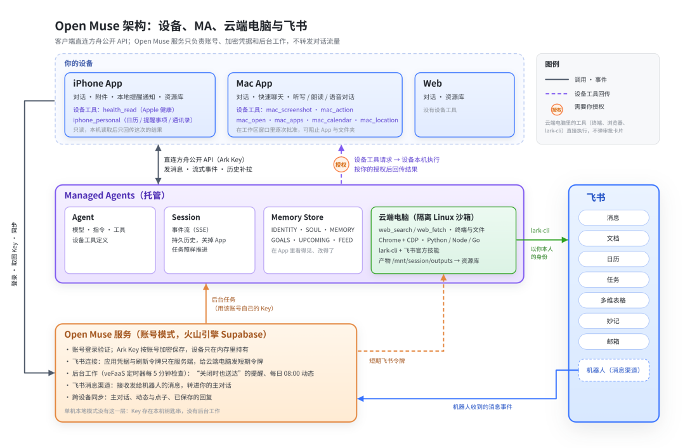

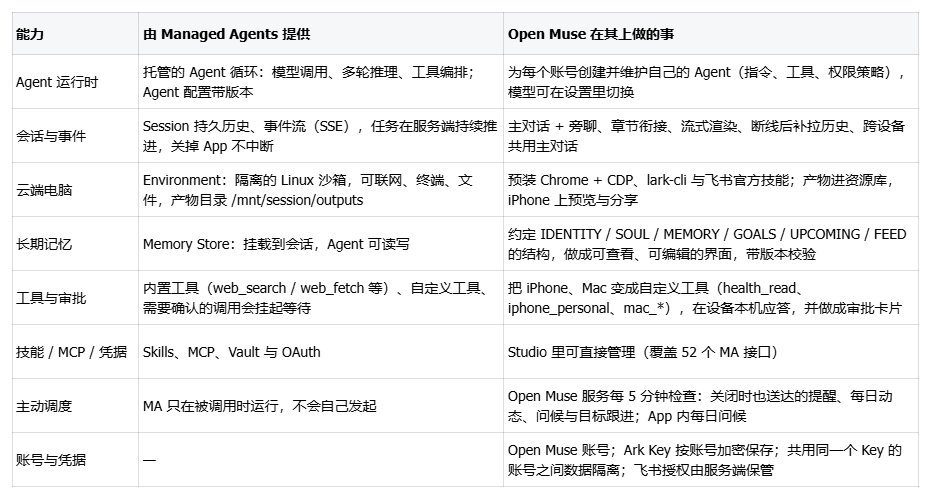

MA 不仅仅提供了稳定的 Agents 运行底座，同时提供了一系列产品能力帮助 Agent 稳定、安全的运行：

### 可观测：Trace 定位与重放

记录 Agent 事件、模型调用、工具结果、上下文与 Session 状态，支持问题定位、复现和全状态重放。

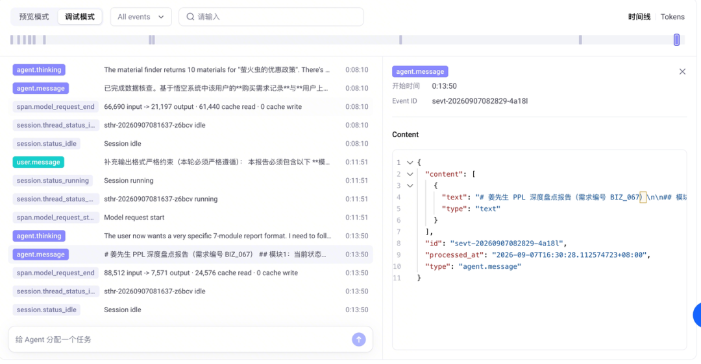

MA 调试模式：查看事件、模型调用与 Session 状态

### 长 Loop / 上下文稳定性

原生承接上下文持久化、断点续跑与异常重试。

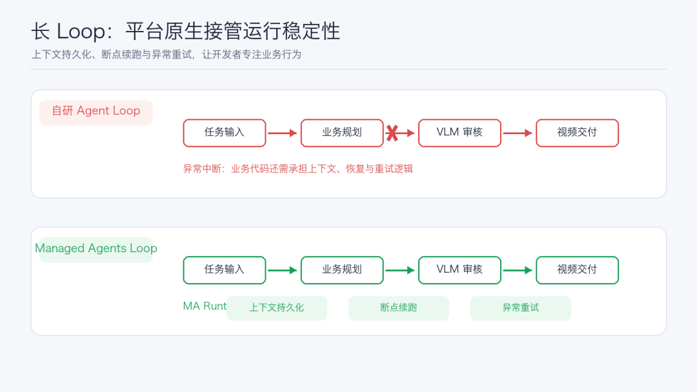

长 Loop：MA Runtime 原生接管稳定性能力

### Session 隔离与弹性

按 Session 隔离 Runtime、状态与文件空间，并随并发负载横向扩展；计算时占用资源，空闲时释放。

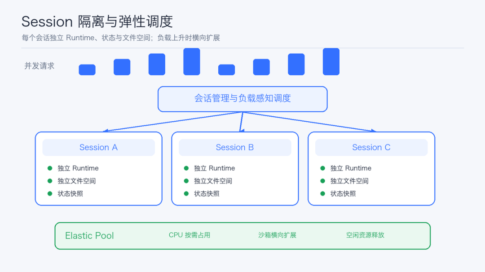

Session 级隔离与弹性资源调度

### 丝滑的文件流转

通过 File API 与 TOS 挂载承接输入素材、中间产物和最终成片的上传、持久化与回传，打通长任务文件链路。

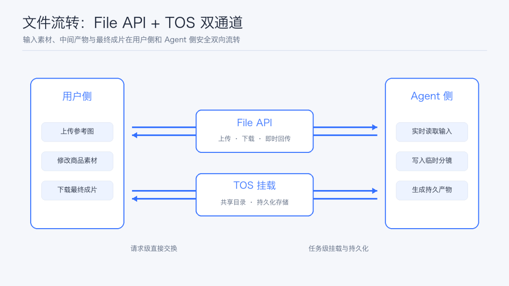

File API 与 TOS 双通道文件流转

## 二、什么是主动式：不用你开口，它会来找你

* **每日问候：**安静一段时间后，按你的目标、最近的话题或偏好主动问一句（白天、每天最多一次）

* **到点提醒：**一次 / 每天 / 每周 / 每月 / 每年的近期提醒，到点出现在主对话；账号模式下打开“Open Muse 关闭时也送达”，App 关着也会投递

* **每日动态：**账号模式下服务端每天 08:00 按你的记忆、目标和指令生成一批动态

* **目标跟进：**进行中的目标会被定期追问进展，计划随实际完成度调整

* **回复完成通知：**刚离开 App 时还没写完的回复，写完后 iPhone 会通知你（iOS 只留约一分钟后台时间）；更长的任务在云端继续跑，回来时结果已在对话里

## 三、使用案例

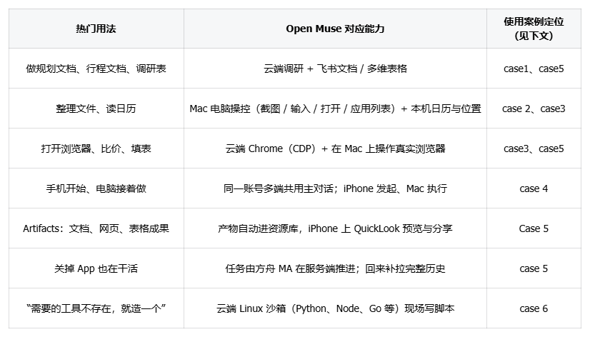

### 3.1 IM 功能结合：一句话办完飞书里的事（云端 lark-cli） ###

**先连上飞书：**iPhone 上 设置 → 连接器 → 飞书 → 连接，按两步走：选择飞书应用、授权你的账号，完成后显示“已连接为 你的名字”。之后任何对话都直接以你的身份操作飞书，新对话、换了新的云端电脑也不用再授权；应用凭据和刷新令牌只保存在 Open Muse 服务，云端电脑只拿到短期令牌。Mac 版和单机本地模式还没有这个面板，点“连接”会在对话里起草一句“用 lark-cli 登录飞书”，由助手给出授权链接。

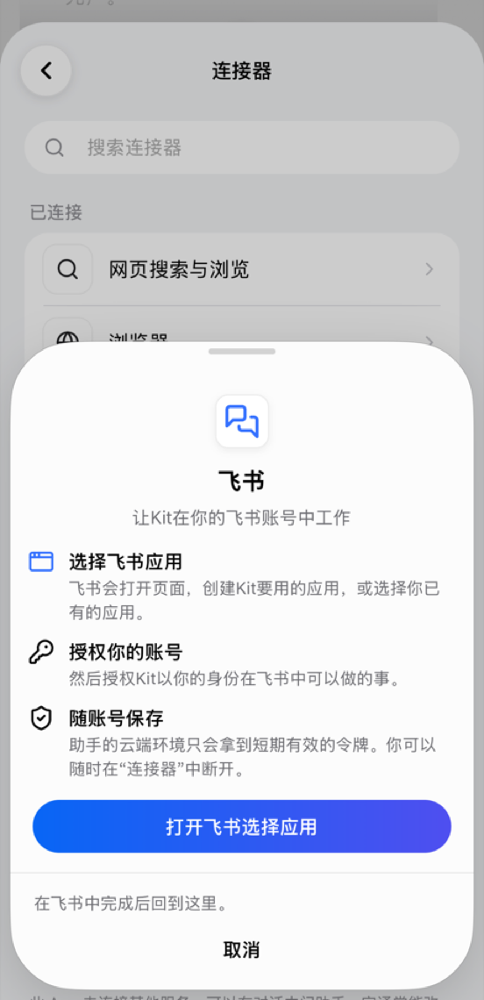

连接飞书 · 第一步：

选择飞书应用

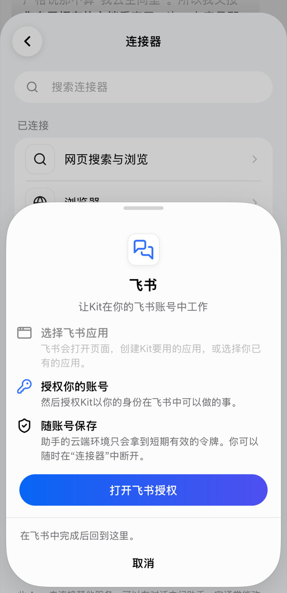

连接飞书 · 第二步：

授权你的账号

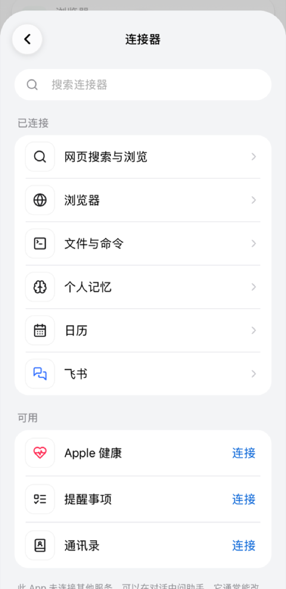

连接飞书 · 连接器：

飞书已连接

### case1｜会后整理：纪要和任务

**一句话指令：**把昨天下午那场会的妙记整理成纪要，写成飞书文档；待办建成飞书任务，创建之前先给我看。

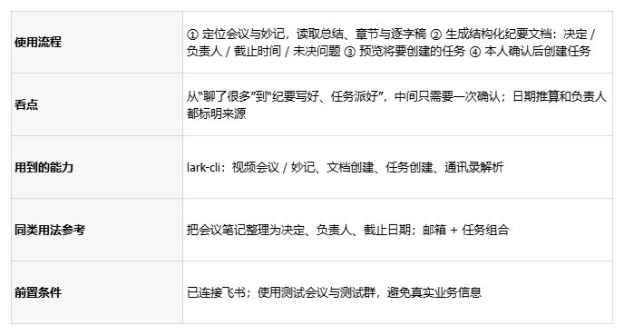

**实测结果：**用虚构示例逐字稿实测：助手整理出会议信息、关键数据、决定、问题和待办，写成一篇飞书文档放在本人云空间，回读确认只有本人可见，并指出逐字稿的时间线与当天对不上、因此没有折算日期。任务部分先列出预览请本人确认，确认后创建，独立核对任务成员都只有本人。从群讨论整理时，还能标出哪些截止日期是它拟的、哪些负责人需要先对应到真实账号。

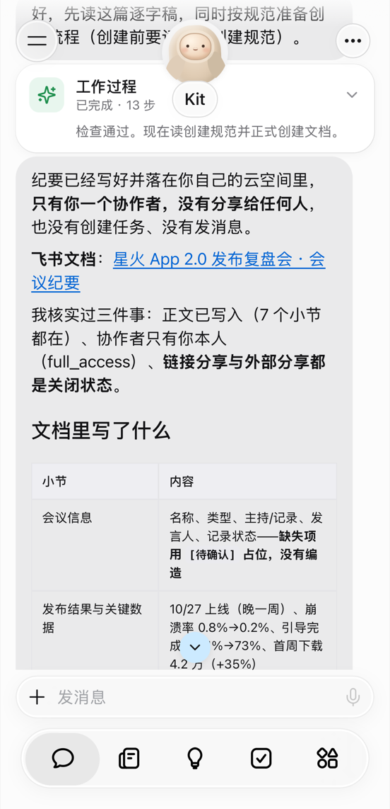

case4 · 逐字稿整理成纪要文档，仅本人可见

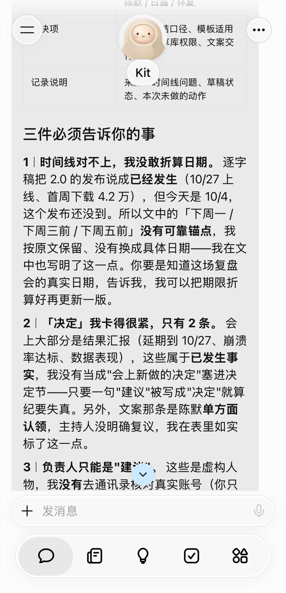

case4 · 如实说明时间线与建议负责人

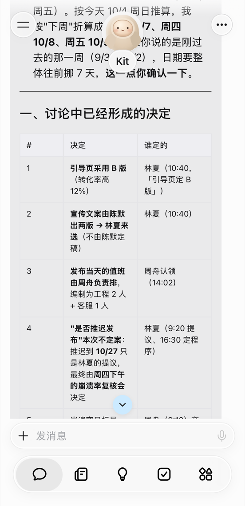

case4 · 从群讨论整理出决定与分工

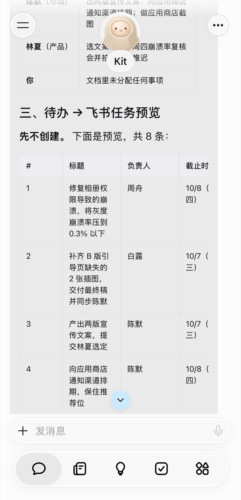

case4 · 飞书任务预览，确认后才创建

左右滑动查看更多精彩内容

**case2｜找空档、排时间（飞书 / iPhone / Mac 日历）**

**一句话指令：**约张三和李四下周找 30 分钟，大家都有空的时段；或者：我今天下午有空吗？

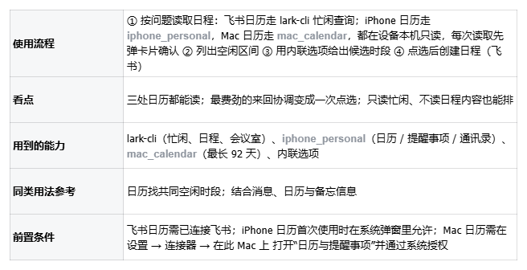

**实测结果****：**飞书：只查本人下周工作日忙闲，助手不读日程内容，给出 3 个 30 分钟候选并用内联选项让本人选择；在本人日历创建日程也已实测（见场景 A）。iPhone：卡片写明读取“10月4日 – 10月5日”，允许后读到当天只有“国庆节（休）”全天标记，判断下午空闲。Mac：一次批准即读到明天只有假期全天标记。多人忙闲、会议室预订、提醒事项与通讯录尚未实测。

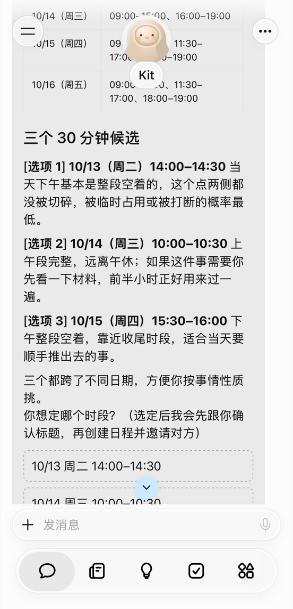

case5 · 飞书：只看空闲时段，用内联选项给出候选

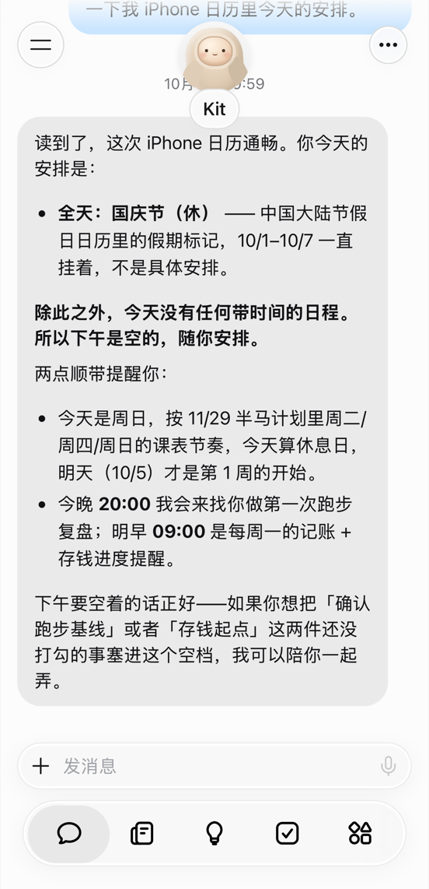

case5 · iPhone：授权后读取今天的日历并回答

### 3.2 手机和电脑双端：跨设备操作 ###

### case3 | 打开任意 App，把事办完

**一句话指令：**打开文本编辑，新建一个文档，把刚才群聊里的待办抄进去。

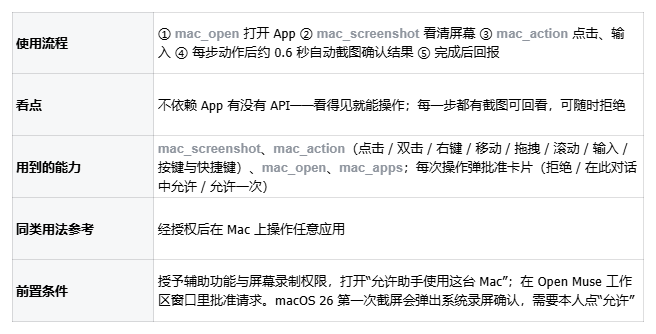

**实测结果：**助手打开文本编辑，写入三条待办；中文输入法开启时也能正确输入。建议先打开空白文档，让文本编辑和 Open Muse 窗口并排、互不遮挡。同样的方式还可以代填网页表单（停在提交前）、整理桌面文件，这两种尚未实测；密码、证件号等敏感信息不要交给助手填写。

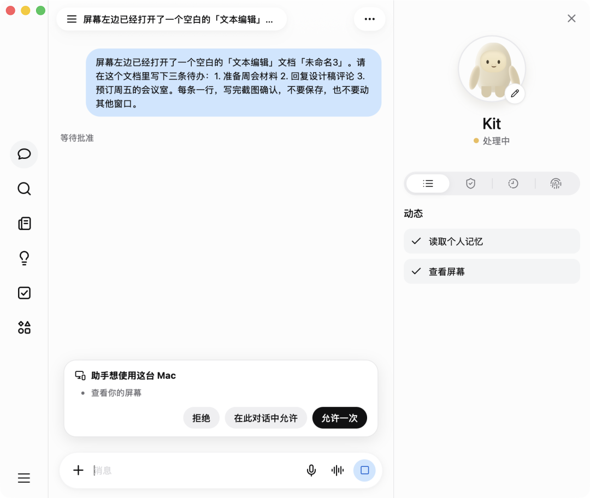

case8 · 每次操作前的批准卡片

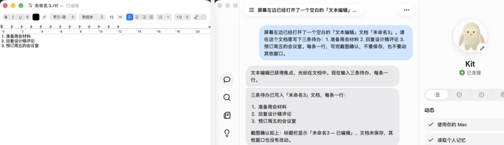

case8 · 助手在文本编辑里写入三条待办

### case4｜手机指挥 Mac，换设备接着聊

**一句话指令（在 iPhone 上）：**用我的 Mac 打开文本编辑，把今天新建的那几条任务记成我自己的待办。

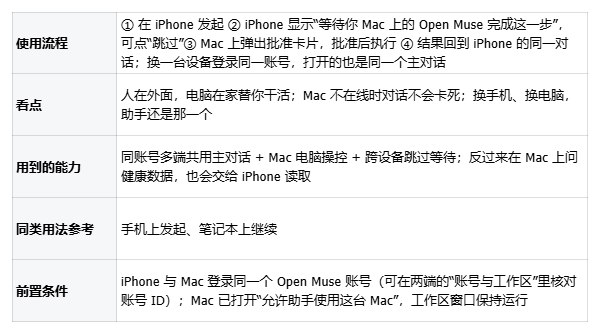

**实测结果：**iPhone 发起后显示等待 Mac；Mac 上批准“打开 文本编辑”，助手只读查出飞书任务，在新建文档里写下标题和截止日期（见场景 B）。两台设备同时登录同一账号时，两边打开的是同一个主对话。“在 Mac 上问、iPhone 来答”尚未实测。

case9 · iPhone 上等待 Mac 执行，可点“跳过”

### 3.3 云端电脑：关掉 App，它也在干活 ###

### case5｜真浏览器调研，交付成表

**一句话指令：**比较三款降噪耳机在京东和官网的价格、续航和重量，每个页面截图留证，做成表格。

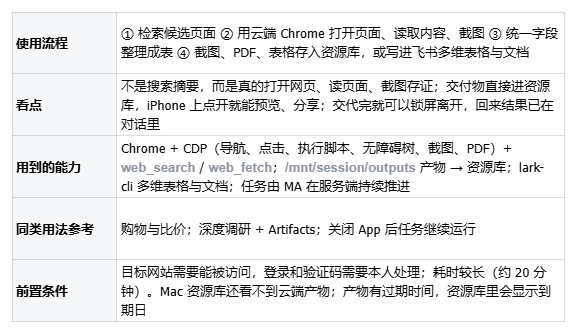

**实测结果：**比价一轮约 60 步、约 20 分钟，交付对比表、7 页 PDF、Markdown 表格和 11 张证据截图，均存入资源库；助手如实说明京东对未登录访客隐藏正式标价、部分页面被频控，改用官方规格页并注明口径。调研 10 款 AI 助手时，在本人云空间建了 12 字段 × 10 条的多维表格和一页结论文档，均未分享。另一次调研发出后立即关掉 App，12 分钟后重新打开，完整结果已在对话里。

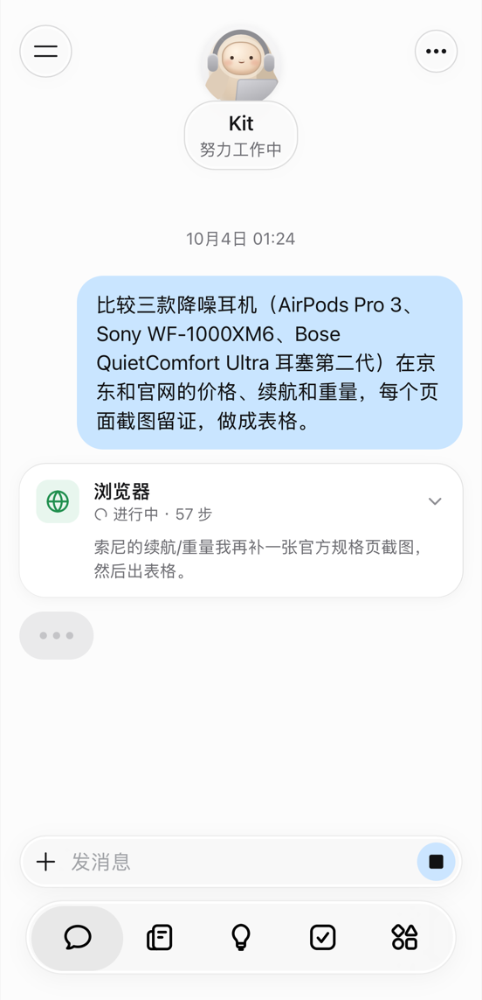

case10 · 云端浏览器逐页取证中

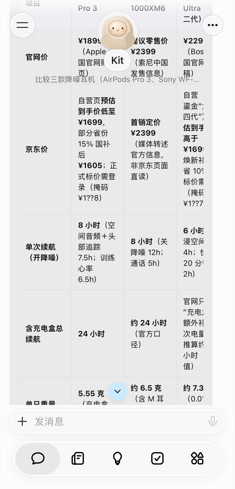

case10 · 最终对比表（每个数字注明来源口径）

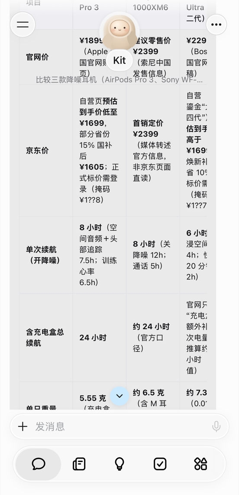

case10 · 最终对比表（每个数字注明来源口径）

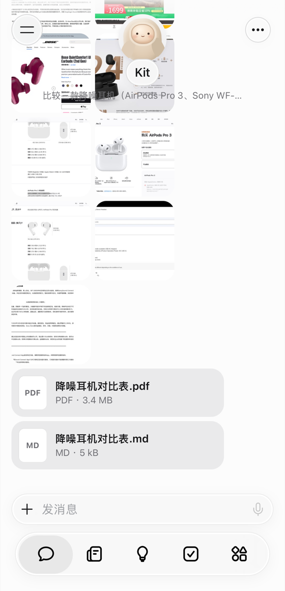

case10 · 证据截图与资源库里的交付物

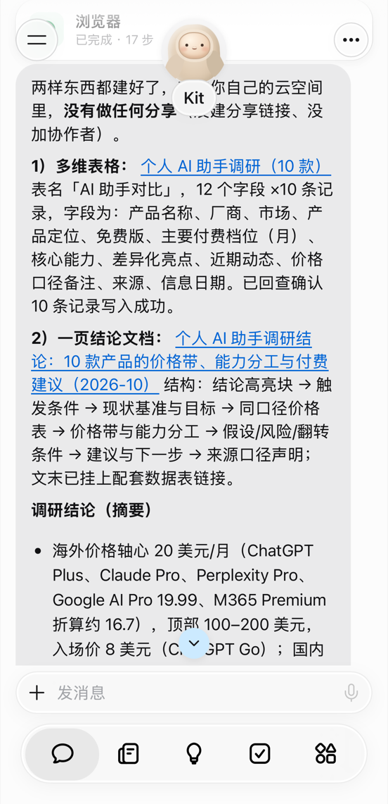

case10 · 多维表格与结论文档已创建（仅本人）

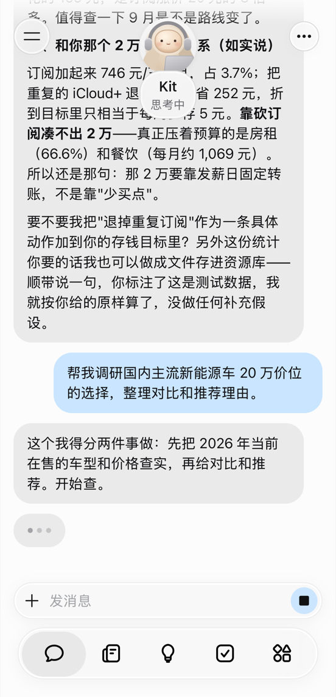

case10 · 发出指令后立即关闭 App

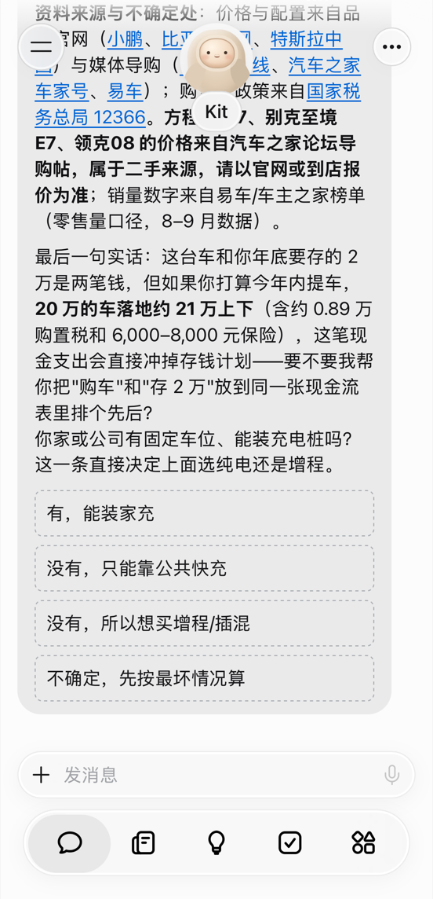

case10 · 重新打开时结果已就绪

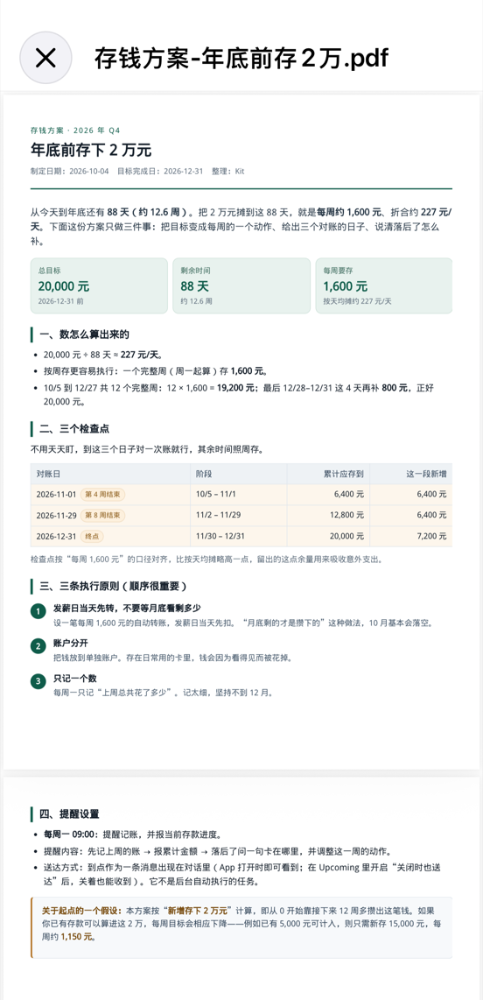

case10 · 资源库里预览 PDF

左右滑动查看更多精彩内容

### case6｜没有工具，就现场写一个

**一句话指令：**（附上导出的账单 CSV）按类别统计这三个月的支出，找出涨价和重复扣费的订阅。

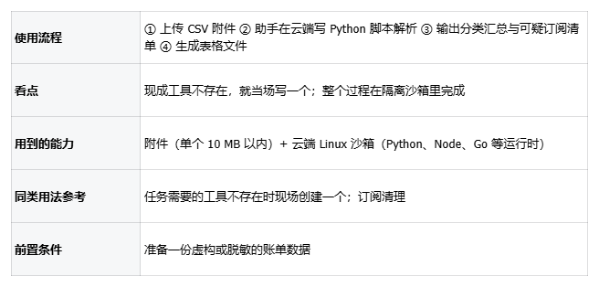

**实测结果：**实测把 84 行合成账单直接贴进对话（没有走 CSV 附件）。助手按类别汇总三个月支出，准确找出两项涨价订阅和一组疑似重复扣费，区分了“功能重叠”和“真重复”，还把结论关联回存钱目标；推断部分明确标注需本人核对。CSV 附件这一步尚未实测。

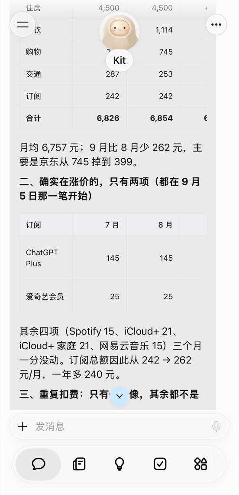

case11 · 分类汇总与涨价订阅

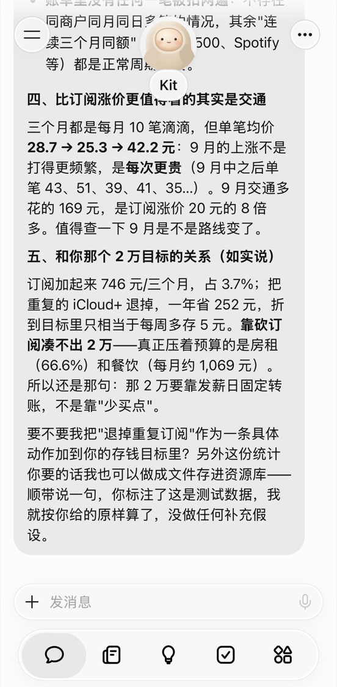

case11 · 重复扣费判断与和存钱目标的关系

## 四、组合场景：多个能力串成一件事

单个案例展示一种能力，组合场景展示“像一个真正的助手”：一句话里串起多个系统。

### 场景 A｜私人运动教练

**一句话指令：**看看我今天练得怎么样，按我这周的睡眠调整一下半马计划，把下周的训练时间排进飞书日历（只放在我自己的日历里，不要邀请任何人），周日晚上提醒我复盘。

1. iPhone 读取运动、心率、睡眠，助手给出今日分析：未连接 Apple 健康时先弹出连接面板，连接后读取当天训练、锻炼分钟、步数和本周睡眠、静息心率

2. 按睡眠调整下周计划：助手判断“总量够、节律乱”，量不降级、把训练时间固定下来，给出周二 / 周四 / 周六 / 周日四次训练

3. 查飞书日历空闲时段，确认后创建训练日程：助手先查这几个时段有没有冲突、列出待建日程请本人确认；确认后在本人主日历建了 4 个日程，回读确认没有参会人、没有会议室、没有视频会议

## 4. 周日复盘提醒：助手发现已有每周日 20:00 的复盘提醒，没有重复创建

**看点：**健康数据 × 目标 × 飞书日历 × 提醒，四个系统一句话打通。

场景 A · 确认后在本人日历创建 4 个训练日程，回读无参会人、无会议室

### 场景 B｜会后十分钟

**一句话指令：**把刚才那场会整理成纪要文档，待办建成飞书任务（全部只指派给我自己），再在我 Mac 的文本编辑里记一份我自己的待办。

1. 读取会议记录，生成纪要飞书文档：用示例逐字稿实测，文档建在本人云空间，回读确认只有本人可见

2. 预览任务清单，确认后创建：助手先列出 4 条任务（截止日期按会上说法推算）请本人确认，确认后创建；独立核对 4 条任务的成员都只有本人

3. 在 Mac 上打开文本编辑写入个人待办：iPhone 发起后，iPhone 显示“等待你 Mac 上的 Open Muse 完成这一步”和“跳过”；Mac 上弹出“助手想使用这台 Mac · 打开 文本编辑”，选“在此对话中允许”后，助手只读查出 4 条任务，在新建的文本编辑文档里写下标题和截止日期，没有改动已打开的旧文档

**看点：**云端飞书操作与本机 App 操作在同一条任务里衔接；Mac 不在线时对话不会卡死，可以跳过。

场景 B · 任务建好后等待 Mac 执行，可点“跳过”

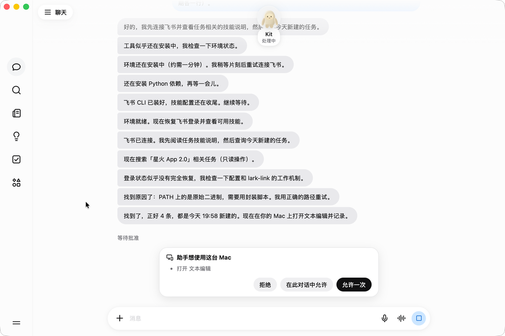

场景 B · Mac 上的批准卡片：打开 文本编辑

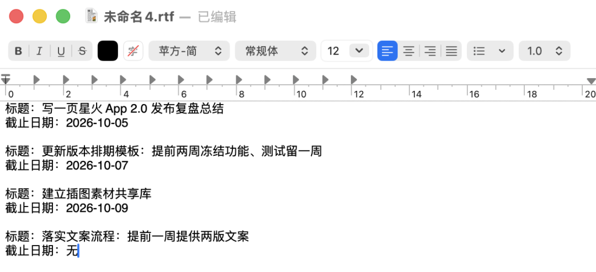

场景 B · 助手在新建的文本编辑文档里写下 4 条待办

## 五、结语

主动式个人 Agent 正在从“能回答问题的助手”，走向“能持续推进目标、关掉 App 后仍在后台干活、需要敏感操作前先征求同意的个人工作伙伴”。而 火山引擎 Managed Agents 的价值，正是把这类体验背后最重的底座能力——Agent 运行时、持久会话、云端环境、长期记忆、工具接入与审批机制——托管起来，开发者不必从零自建基础设施，只需在 MA 之上补齐设备连接、主动触达、账号与体验，就能更快搭建出真正贴身、可控、可持续进化的主动式个人 Agent。

