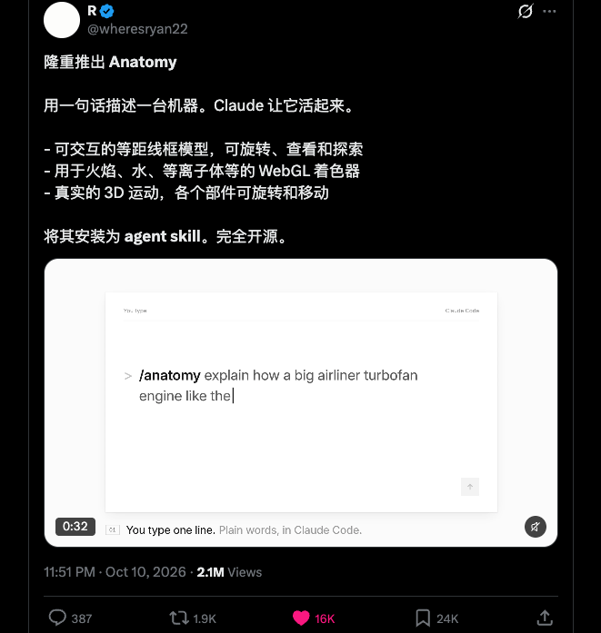
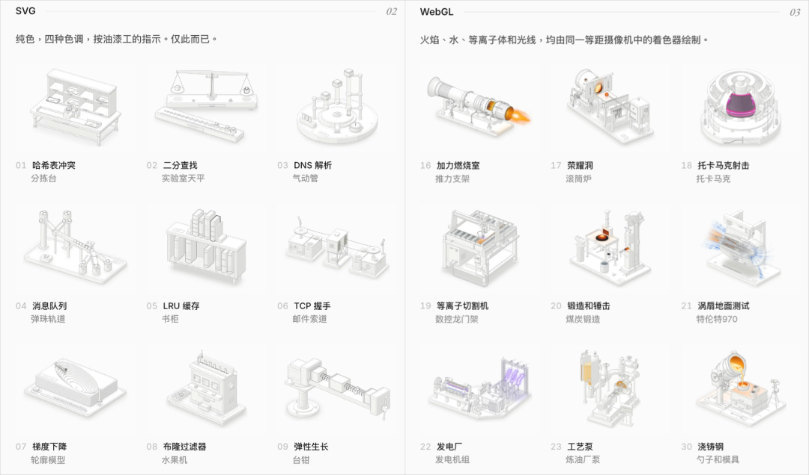
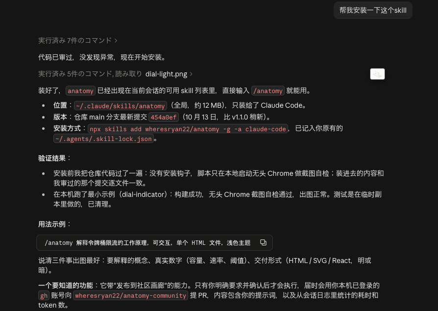
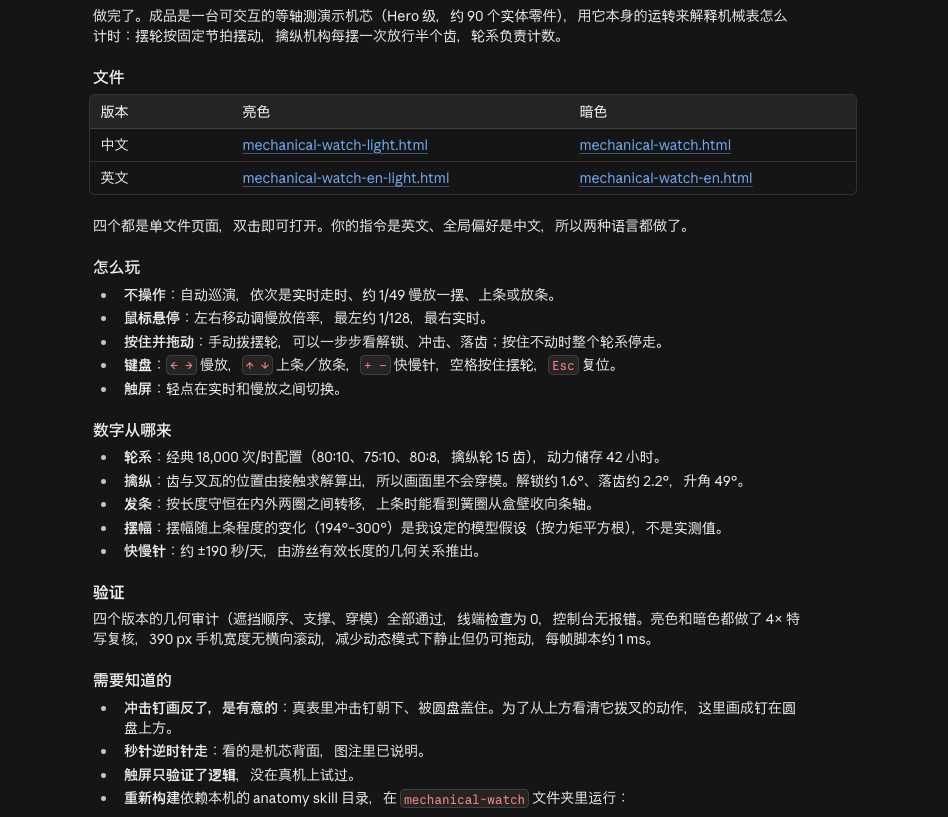
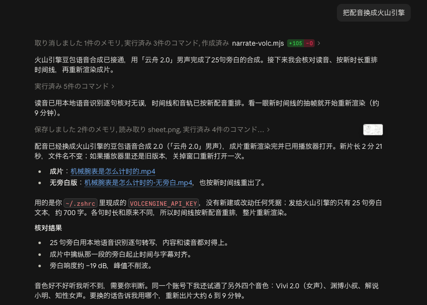
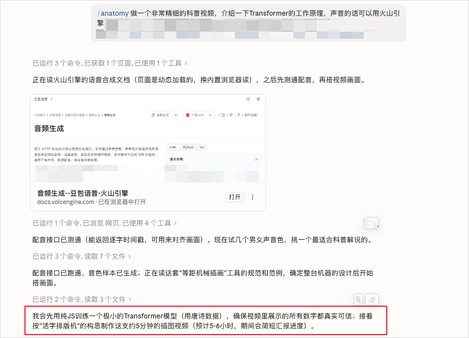
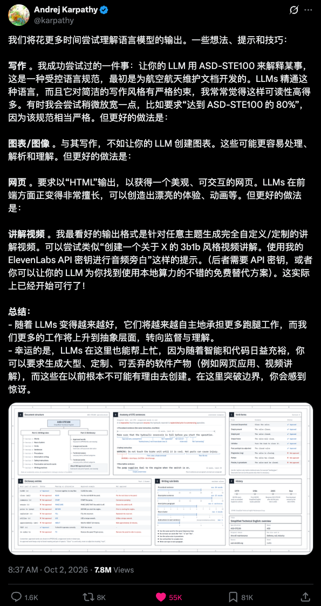
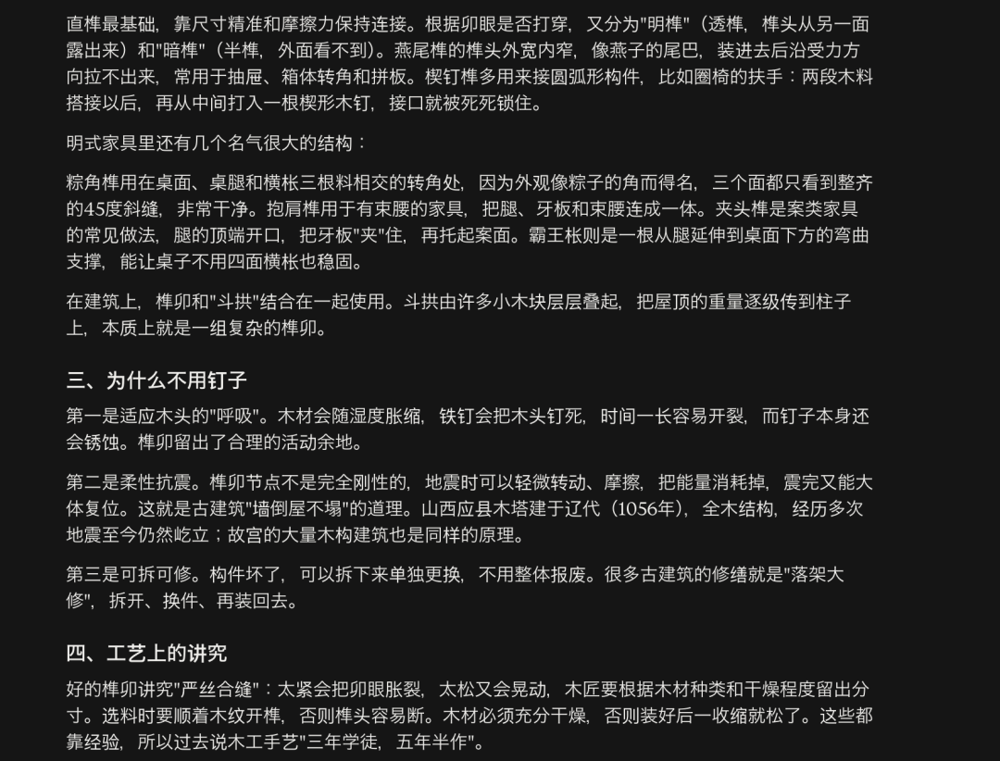
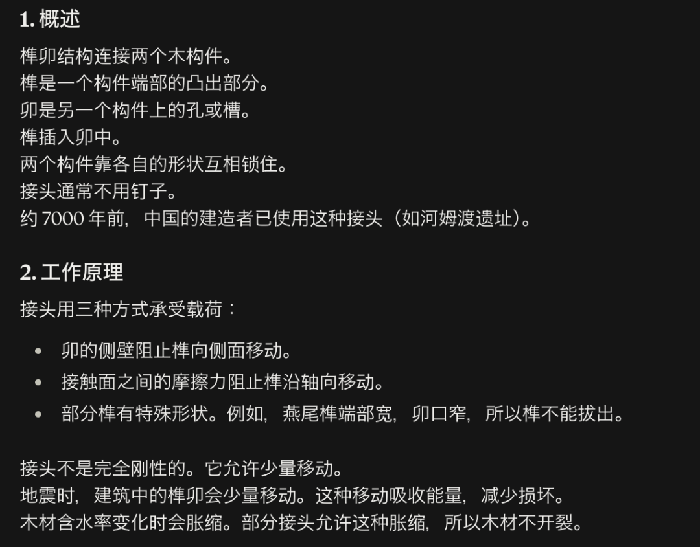
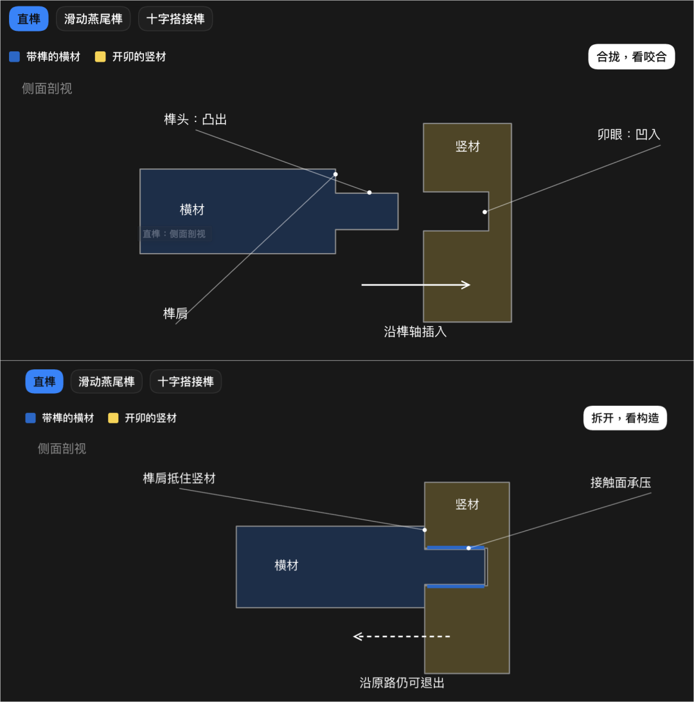

# 📰 分享一个最近很惊艳的开源Skill，一句话让AI搓出任何原理的科普视频。

前两天发现了一个超棒的Skill，可能很多朋友也都刷到了。

叫Anatomy，中文含义是深度剖析。



这个东西，我觉得特别有意思。

它的核心设计理念，只有一句话。

The object is the explanation.

物体本身，就是解释。

相比用文字来解释，Anatomy的思路是，它会尝试把你要理解的原理，做成一套真正能够运转的装置，让你亲眼看到整个过程。

直白一点说就是，它会把抽象知识，直接让Agent做成一个可以动、显示出完整零件、可以交互的机械模型动画。

而且做出来的东西，相当好看和精细。

比如，你想知道一块机械手表，内部到底是怎么工作的。

审美是我超级喜欢的风格，在交互上，你也可以自己手动转发条，看里面的零件是怎么运转的。也可以把各部分的零件拆开来观察它们的结构。

这个效果，是作者用下面这行提示词跑出来的。

/anatomy explain how a mechanical watch keeps time, interactive

翻译一下就是，做一个交互演示，解释机械表是怎么计时的。

类似的案例还有很多。



甚至，你还能拿他做一个带1/4剖面的劳斯莱斯Trent 970发动机。

不光是把发动机的外壳画出来了，里面的风扇、压气机、燃烧室、涡轮等等结构都画的非常详细。

说实话，我第一次看到这些动画的时候，真的觉得非常酷。

尤其是对于那些喜欢研究机械结构、物理原理的朋友来说，感觉有太多可以玩的了。

要用上这个skill很简单，直接打开你的Agent跟他说找一下最近很火的Anatomy skill安装。

或者，直接复制下面的提示词发给你的Agent。

```

帮我安装一下这个skill：https://github.com/wheresryan22/anatomy/tree/main

```

安装好之后，就可以开玩了。



不过，等我自己多跑了几个之后，发现了一个挺重要的问题。

拿上面的腕表动画为例，就是这些动画虽然确实很好看。但我作为一个对机械表内部结构没什么了解的人，看了会儿就有点懵了。

每个零件是啥，起啥作用，时间到底是咋计算的？

即使我仔细对着动画看了一遍这个skill自带的文字讲解，理解起来也是相当费劲。



对于本来就懂原理的人来说，这种简洁又高度精细化的机械动画，确实能帮助他们更直观地观察机械结构。

但如果我原本就对这个东西一窍不通，那画面再精致也还是看不懂。

所以我觉得，对于没有相关知识基础的朋友，光让物体本身运动来解释是不够的，最好还是有讲解能在旁边，一边展示，一边告诉我，这个玩意是啥，现在在发生啥，为什么，以及有啥用。

所以，我就想到，既然这个skill已经能帮我们把这些复杂的原理做成动画了，那要不要干脆让AI在它的基础上，直接生成一段有讲解、有配音的科普讲解视频。

于是，有意思的东西就出现了。

我同样拿这个机械表工作原理的例子试了试。

用的Opus 5.5，推理强度高。

提示词很简单，就一句。


一轮直出了下面的视频。

除了这个配音因为它默认选了MacOS自带的语音合成显得很奇怪以外，其他方面，都相当的不错。

介绍的很全面清晰，有哪些零件，各个零件的作用，零件之间的关系，计时的原理等等等等，都介绍清楚了。而且如果你仔细去看里面的齿轮，转动的时候，各个齿轮之间是真的卡的严丝合缝的，还有对应的音效，也都配上了。

和上面的纯动画，这种形式对我这种门外汉来说明显友好多了。

看这么一个视频，虽然肯定不到精通的地步，但至少对机械表工作有了一个初步的了解，即使要往下再学，也知道有哪些内容可以继续。

而这个雷霆配音的问题，改起来其实也简单，直接跟它说一嘴换配音，用火山的，一次就弄好了。



我还拿它做了个讲解显卡工作原理的视频。

同样是一次直出，没有任何修改。

它先介绍显卡到底是用来干嘛的，有哪些组件，怎么组装的，一帧画面计算的整个过程，显卡计算为什么快，画面怎么动起来，怎么散热，最后总结显卡的输入输出是啥。

整体的介绍非常结构化，并且讲到哪个部分，画面就展示或者高亮哪个部分，非常清晰易懂。

这里介绍的相对简略一点，你要是想要更加详细的，在提示词里面加上要求就行。

比如，我让它做了一个比较详细的TCP三次握手科普视频。

这里用的是Opus 5.5 Ultra强度。

除了里面有的英文读的发音有点问题之外，视频的质量相当高了。

我也发给公司一个通信出身的小伙伴看了，她说这个在她大学的时候是整整一堂课的教学内容，没想到AI手搓一个几分钟的视频就能讲的这么清楚。

然后最近刹车很火对吧，我还拿这个skill给我科普了刹车的构造。

众所周知，这东西还是很重要的，学好了不烧心啊各位。

总之，这两天玩下来，还是非常有意思的。

想了解什么，就让它给自己现做一个，这种感觉就真的非常爽了。

看完了效果，我知道你们肯定很多朋友，都会关心额度消耗和时间问题。

坦率的说，拿这个skill做视频的额度消耗，比我预料的低很多很多。

像前面，5分钟的TCP三次握手视频，大概就花了我200刀的Claude Max会员周额度的1%。

其他时长在5分钟的视频生成，差不多也都是周额度1%左右的消耗。

而且，如果你是为了发到网上给别人看，想把每个零件都做得特别精细，那可能确实需要用到Opus 5.5这样的顶级模型，推理强度拉满。

但如果只是自己拿来学习看，完全可以做一个简单的版本，模型也可以尝试用相对省额度的配置。

我也拿Sonnet 5.5在推理强度高下面做了个科普显卡原理的视频，只是拿来自己看的自己学习的话，效果也绝对是够用的。

耗时上面，上面5分钟时长的视频，Opus 5.5开Ultra强度，基本需要1个半小时左右生成。

这个上面，就不太有办法省了。

Anatomy这个skill的作者是专门把这个skill做慢的。

关于原因他是这么说的。

细节需要时间，所以我宁愿展示真实数字，而不是猜测。

它对真实细节的追求到了什么程度呢。

属于我让它介绍Transformer原理，它要自己去训一个小模型出来的程度，然后就被Claude判定为是敏感行为，直接给我把这个会话给ban掉了，吓尿了。。。



当然，这里也要叠个甲。

AI生成的这些动画和视频，即使看起来非常精细，也不能保证每一处机械结构、计算过程和讲解内容都完全正确。

尤其是拿来学习专业知识的时候，涉及具体参数、关键原理的地方，还是值得再核对一下。

但即使有这些局限，我依然觉得，这个东西所展现出来的可能性，已经非常值得兴奋了。

因为它关乎到的不仅仅是一个科普视频怎么制作，还涉及到另一个更大的问题。

以后，我们到底应该怎么学习一个自己完全不懂的知识？

在玩这个skill的时候，我突然想起了Karpathy国庆节期间在X上发的一篇长帖。



他说，未来我们可能会花越来越多的时间，去理解AI生成的各种内容。

那为了让这些内容更容易被人理解，他分享了几种方法。

第一种，是让AI用更加清晰、简单的语言来解释问题。

他提到一种叫ASD-STE100的技术领域里的英语用语规范。

这套规范最初是为航空维修文档开发的，对用词和句子结构有比较严格的限制，比如限制句子长度，使用主动语态，同样的意思尽量使用同一个词等。

目的就是让表达尽可能的简洁和结构化，减少歧义。

他发现，让AI参考这种规范来写东西，读起来会容易很多。

这里我也在不使用和用这个规范的情况下，分别让Claude给我讲解了一下榫卯，大家可以感受一下效果。



参考ASD-STE100规范之后。



第二种，他认为是比前者更好的方式。

直接让AI画图表示意。



再往上，更好的方式是HTML网页。

因为现在AI编程已经足够强了，可以直接做出一个精美的、可以交互的网页。

这也是Anatomy这个skill本身的主要输出格式。

这里我也随手拿Opus 5.5一轮直出了一个。

而最后一种，也是Karpathy最看好的。

就是让AI针对某一个具体问题，直接生成专门的科普讲解视频。

同样我也拿Anatomy这个skill做了一个，方便大家对比各种形式的效果。

在我看来，这几种形式其实并不是简单地谁替代谁。

文字适合快速查阅，图表适合展示关系，交互网页可以让人自己动手探索，而视频则更直观的让我们按照一定的顺序，一步一步理解一个过程。

不同的知识，不同的人，不同的学习阶段，适合的形式可能都不一样。

我也去问了公司小伙伴在很久以前，大学的时候，是怎么开始学习一个完全不懂的知识的。

基本回答都差不多，要么是搜索引擎搜一下，要么是去各个平台上找找有没有相关的科普视频。

但你能找到的学习材料，未必就是适合你的。

有的会太浅，有的又可能太过专业，甚至对于过于冷门的知识，都不一定能找到对应的课程。

归根结底，过去的学习材料，大多数是有人提前制作好，然后再分发给所有人看的。

我们只能从别人做好的内容里面，寻找最适合自己的那一个。

但现在，有了Opus 5.5这样的模型，有了Anatomy这样的Skill，我们已经能让AI按照自己的需要，临时生成一份学习材料。

不仅仅是帮我们省下找资料的时间，它可能能够让很多原本会被我们放弃的好奇心，真正有机会得到满足。

哪怕你只是突然对某一个很小的问题产生了好奇，随手就可以让AI专门为这个问题做一个视频讲解。

多棒的时代啊。

******以上，既然看到这里了，如果觉得不错，随手点个赞、在看、转发三连吧，如果想第一时间收到推送，也可以给我个星标⭐～谢谢你看我的文章，我们，下次再见。******

\>/ 作者：卡兹克、tashi

\>/ 投稿或爆料，请联系邮箱：wzglyay@virxact.com

