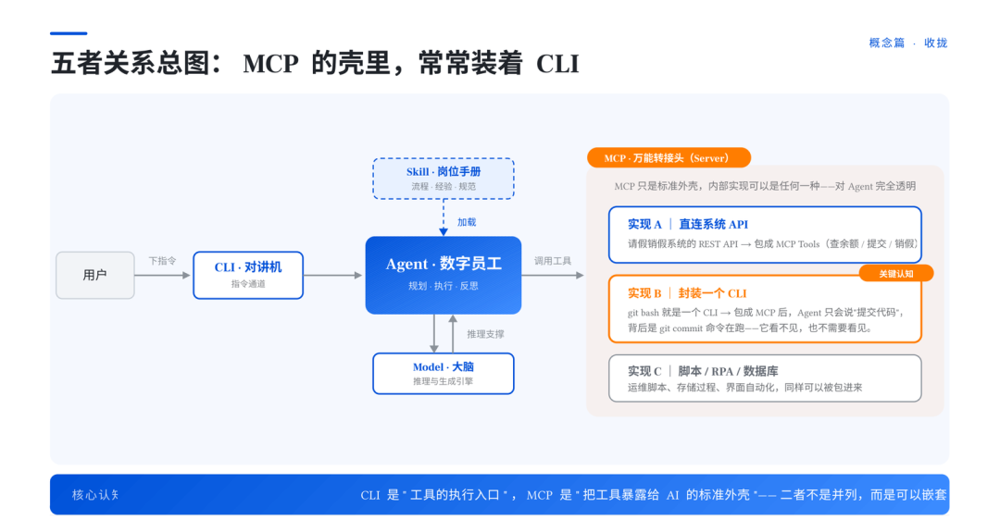
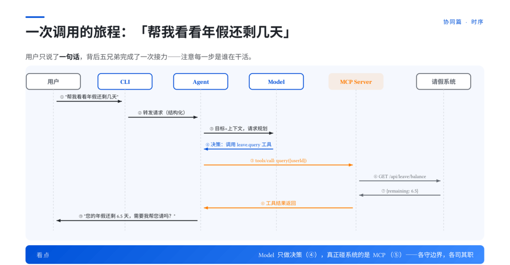
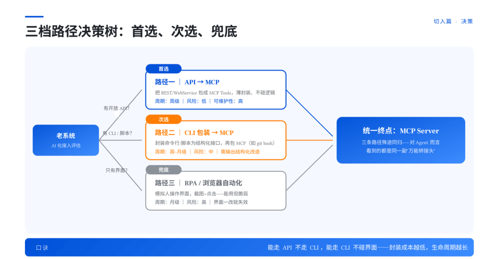
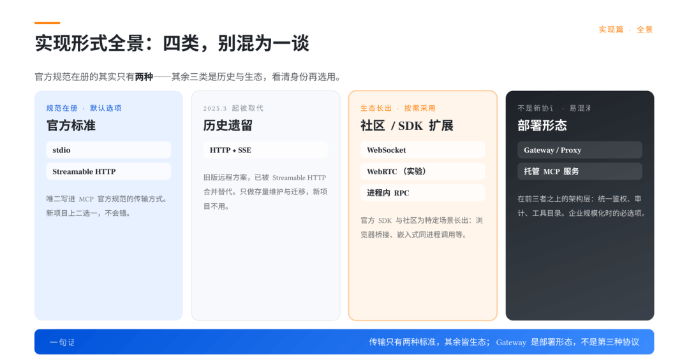
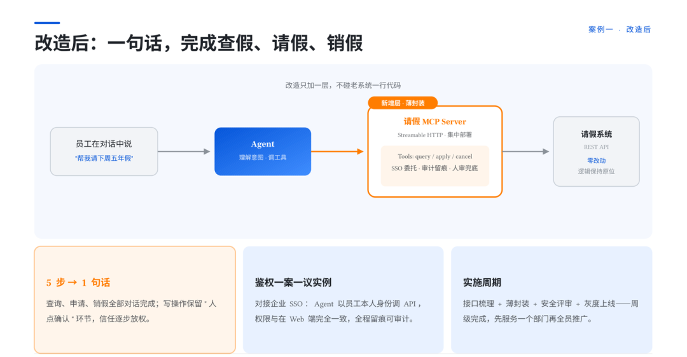
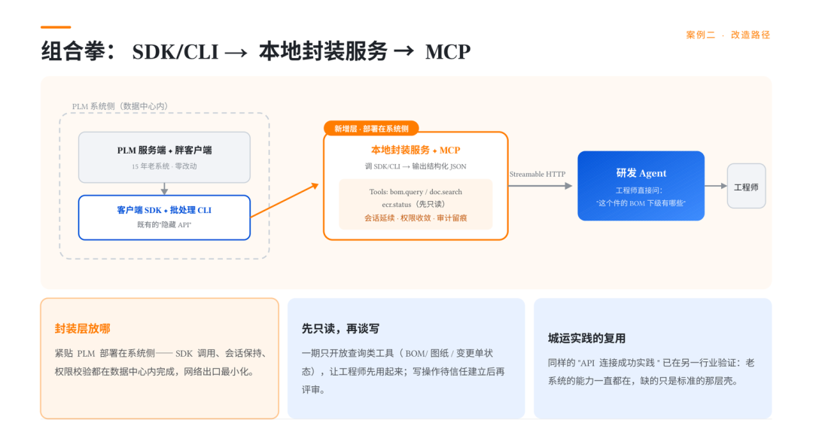
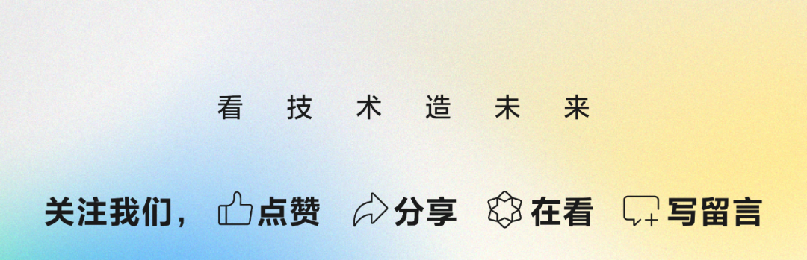

# 📰 Agent、MCP、Skill、Cli、Model 一次讲透：老系统接入 AI 的概念地图与三条路径

作者：robinji

>
>
> 这篇文章尝试回答两个问题：一是 Agent、Skill、MCP、CLI、Model 这五个概念到底是什么关系，谁调用谁；二是企业里跑了多年的老系统，该从哪里切入，AI 才用得起来。内容包括五概念的关系总图、一次工具调用的完整接力、老系统接入的三条路径（API 封装、CLI 包装、RPA 兜底）、MCP 实现形式的完整分类，以及 BS 和 CS 两种架构的实战案例。
>
>

## 一、事情的起因

客户是国内某大型整车集团研究院的 IT 团队。集团管理层给他们下了一个课题，「让 AI 深入老业务系统」。这个提法里没有「上一套新的 AI 系统」。这两个说法差别很大，做过企业 IT 的人都懂，上新系统是采购问题，深入老系统是工程问题。管理层点了名，这道题躲不掉。

IT 同学犯难的地方，先出在概念层。Agent、Skill、MCP、CLI、Model，这些词现在满天飞。它们之间到底是什么关系，谁调用谁，标准和工具各是哪几个，平时没人系统讲过。

更实际的问题是，手里那些跑了十年八年的老系统，请假销假、PLM、各种内部平台，到底该从哪里下刀，AI 才用得起来。客户的需求很朴素，先讲明白，再谈怎么改。于是有了这场交流和那份 42 页的 PPT。

## 二、五个概念构成一支团队

客户的第一个问题是，这些概念到底是什么关系。我们的办法是打比方。别背技术名词，把整套 AI 系统想象成公司新入职的一支数字化团队。

|  **概念**  |**团队角色**|          **干什么**          |
|----------|--------|---------------------------|
|Model（大模型）|   大脑   |        负责想，推理与生成引擎        |
|  Agent   |  数字员工  | 负责干，目标驱动、自主规划、调用工具的闭环执行体  |
|  Skill   | 岗位技能手册 |负责会，把流程和经验封装成 Agent 能加载的技能包|
|   MCP    | 万能转接头  |  负责接，连接 AI 与外部系统的开放标准协议   |
|   CLI    |  对讲机   |  负责说，指令清晰、回执明确、可记录的交互通道   |

这里来逐个展开说说。

1. Model 是大脑。它有参数量、上下文窗口、多模态这些属性，但大脑再聪明，没有手脚也干不了活，模型本身碰不到你数据库里的一行数据。

2. Agent 是数字员工。你给它一个目标，它自己拆任务、找工具、执行、看结果、再调整，感知、规划、行动、观察、再规划，这是个闭环。最容易混的一点先说掉，Agent 是一套系统，Model 只是它的一个部件。

3. Skill 是岗位手册。新员工入职发一本手册，通用员工就变成领域熟手。Skill 干的就是这件事，触发条件加操作流程加领域知识加工具清单，工程化、可以版本管理的流程资产。它和 Prompt 不一样，Prompt 是随口叮嘱一句，Skill 是写进员工手册的 SOP。

4. MCP 是万能转接头，也是整场的重点。官方名字 Model Context Protocol，一个开放标准协议。一边是 Agent，一边是任意系统，数据库、API、文件、设备，不管什么插头，统一接口标准。

5. CLI 是对讲机，命令行接口。它有双重身份，给工程师用是高效操作，给 Agent 用是结构化调用。

五个概念摆完，还有一对关系容易被漏掉。MCP 和 CLI 可以嵌套。一个 MCP Server 的内部实现，常常就是封装了一个 CLI。最小的例子，把 git bash 封装成 MCP Server，Agent 通过 MCP 协议间接调用 git 命令。对 Agent 来说，它只看到 MCP 这个标准外壳，背后是 CLI、API 还是脚本，它不需要知道。说得再直白一点，CLI 管工具怎么执行，MCP 管怎么把工具标准地暴露给 AI。记住这个嵌套关系，后面讲老系统改造会反复用到。

## 三、它们怎么协同

概念讲完，第二个问题很自然。用户说一句话，背后到底发生了什么。就拿「帮我查一下上周的请假记录」这句话来说，这句话进去以后，背后是一场接力。

用户在 CLI 或者随便什么对话入口里说出这句话。Agent 接到目标，把任务交给 Model 规划。Model 判断这事要查 HR 系统，员工手册里有标准流程。Agent 加载对应的 Skill，按流程找到该调用的工具，通过 MCP 协议向请假销假 MCP Server 发起调用。MCP 服务器再去调老系统的 REST API。结果沿原路逐层返回，Agent 用人话告诉用户，你上周请了两天年假，剩余额度 8.5 天。

这里也把传统软件和AI里的属于尝试做个映射方便理解。

|  **传统软件世界**  |**AI 世界**|
|--------------|---------|
|     微服务      |  Agent  |
|OpenAPI / REST|   MCP   |
|内部 Wiki / SOP |  Skill  |
|  SDK / 命令行   |   CLI   |

看明白这张表，所谓 AI 架构就不再是黑话。它是你画了十几年的架构图，只是上面换了一层内容而已。

## 四、老系统怎么改

这是客户最关心的部分，也是管理层课题的核心。

我们的第一个建议有点扫兴，没有银弹。方案取决于体检结果。

体检看四个维度，API 开放程度、文档完整性、鉴权体系、变更风险承受度。体检完走决策树，一共三条路。

* 第一条，API 封装为 MCP，首选。系统有开放 API，直接在前面加一个 MCP Server 薄封装层。改动最小，最稳定，可灰度。纪律只有一条，封装层只做协议转换，不碰业务逻辑。

* 第二条，CLI 包装，次选。没有 API 但有命令行、有运维脚本，把脚本封装成结构化 CLI，外面再包一层 MCP。前面 git bash 的例子就是这条路的最小样本，技术上的要求是 CLI 输出要结构化，最好是 JSON，Agent 才消费得动。

* 第三条，浏览器自动化或者 RPA，兜底。只剩一个网页界面，连脚本都没有，用浏览器自动化模拟人操作。能用，但脆，页面一改版就失效，它是过渡方案，别当终态。

三条路优先级从上到下，改造深度递减，脆弱性递增。

然后这里要泼一盆关于安全的冷水。鉴权和安全，一案一议。Agent 代替人去操作系统，身份怎么从用户传到 Agent 再传到系统，权限怎么收到最小，操作怎么审计，敏感动作要不要人工确认，行业目前拿不出通用标准方案，每个系统都得单独评审。**谁跟你打包票说有现成方案，谁就没干过企业级落地。**

最后是怎么排序。画一张"使用频次-业务价值"的四象限图，从高频、低风险、有 API 的系统先动手。理由很现实，**第一场仗必须赢，还得赢得便宜。**

## 五、MCP 的实现形式

交流前客户做过功课，问我们 MCP 是不是有 stdio、HTTP、SSE 三种实现。对，但不全对。

这里有个连很多技术文章都搞错的事实。MCP 官方规范里只有两种标准传输方式，stdio 和 Streamable HTTP。SSE 从 2025 年 3 月起就被取代了，是历史方案。

完整的版图分四类。官方标准两种，stdio 和 Streamable HTTP，默认选项。历史遗留一种，HTTP 加 SSE，只做存量迁移，别新建。社区扩展一批，WebSocket、WebRTC、进程内 RPC，这些是生态在标准之外长出来的，按需采用。

还有一类最容易混，MCP Gateway、Proxy、托管 MCP，它们属于部署架构，和新协议无关，偏偏最容易跟传输方式搅在一起。一个认知先立住，MCP 是传输无关的，协议逻辑不变，变的只是消息怎么跑腿而已。

几种形式各说几句简要展开。

* stdio，宿主程序直接拉起本地子进程，走标准输入输出，本地开发和桌面 Agent 的标准姿势，代价是单机单客户端，信任关系只在进程级。

* Streamable HTTP，单个 HTTP 端点，POST 发请求，GET 建流收推送，支持会话保持和断线恢复，配 OAuth 2.0，企业内集中部署、多团队共享，官方推荐的远程方式只有它。

* SSE，双端点的早期方案，见到它只有一个动作，规划迁移。

* WebSocket，全双工低延迟，典型场景是浏览器桥接，比如 Agent 连 Chrome 扩展做浏览器自动化，代价是负载均衡要做粘性会话，企业防火墙可能拦升级握手。

选型可以压成四句话。本地开发用 stdio，企业共享用 Streamable HTTP 加 OAuth，SSE 只做存量迁移，WebSocket 留给实时和浏览器场景。

## 六、两个案例

光讲方法论客户不认，得有实战。我们选了两个，一个 BS 架构，一个 CS 架构。

第一个，某头部车企的请假销假系统，BS 架构，走第一条路。Java Web 系统，有 REST API，HR 高频场景。痛点很具体，员工查个假期余额要登录系统点五步，HR 每月还要人工对账。改造做法很直接，REST API 前面加一个 MCP Server，Streamable HTTP 集中部署，鉴权对接企业 SSO，老系统一行代码没动。改完以后，员工在对话窗口说一句帮我请明天下午半天年假，五步变成一句话。

第二个，某欧洲商用车企的 PLM 系统，CS 架构，走第二条路。传统桌面客户端，没有开放 REST API，但客户端自带 API 和 SDK。痛点是数据孤岛，工程师在系统之间人工搬运 BOM 和图纸信息。改造时在 PLM 客户端旁边部署一个本地封装服务，把客户端 API 包装成结构化接口，再包一层 MCP，会话和权限沿用客户端已有的登录态。

两个案例对照着看，有三条经验可以复用。先体检再选路径，别拿着锤子找钉子。封装要薄，不碰业务逻辑，封装层越薄项目死得越慢。鉴权一案一议，把它写进项目计划，别当意外处理。

## 七、效果

交流结束后，客户给了好评。用他们的话说，这场分享把 Agent、MCP 这些词的关系讲清楚了，三档路径的决策树拿回去就能对着自己的存量系统用。

我们自己复盘，一场对客户的技术交流做到这一步就算及格。标准只有一个，对方听完觉得这事我们自己就能干。

## 关于腾讯智慧出行

**腾讯智慧出行已合作超过100家车企和出行科技公司，与长安、上汽、广汽、零跑等多家车企在AI领域开展探索，围绕腾讯Workbuddy、Codebuddy、ADP和乐享等AI产品，以FDE模式与车企共同落地研发、销售、企业服务等多个场景应用。**

