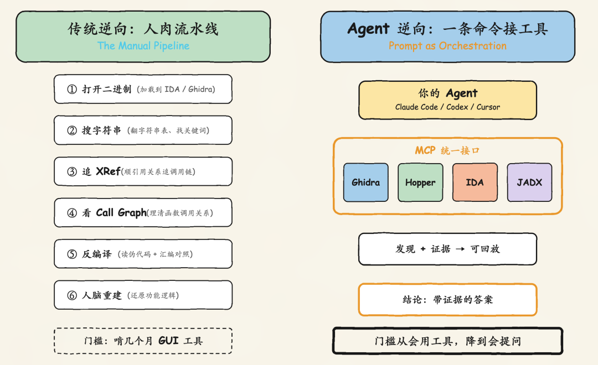
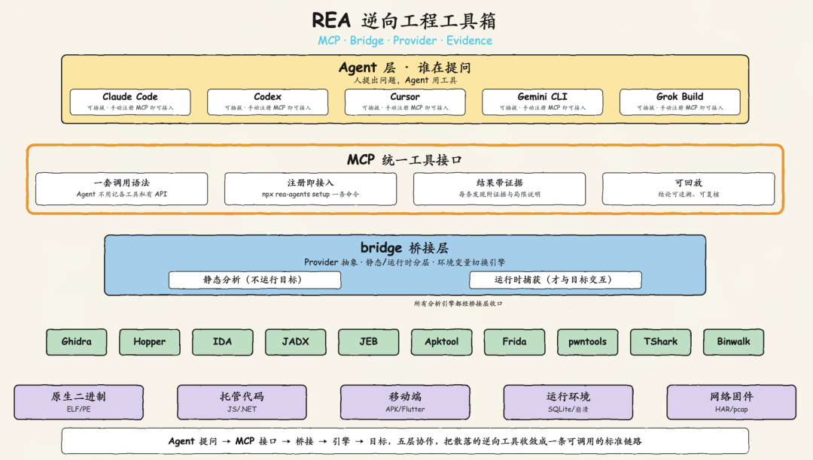
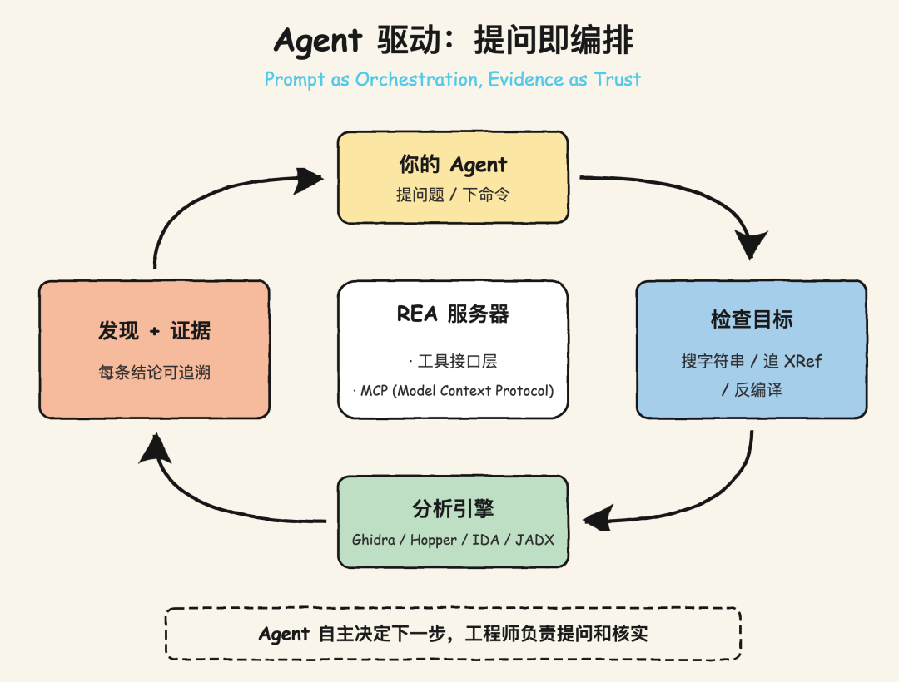
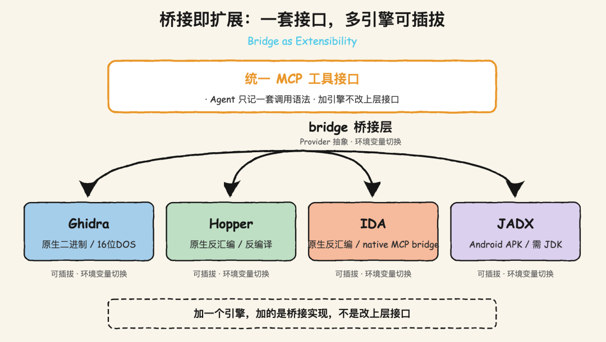
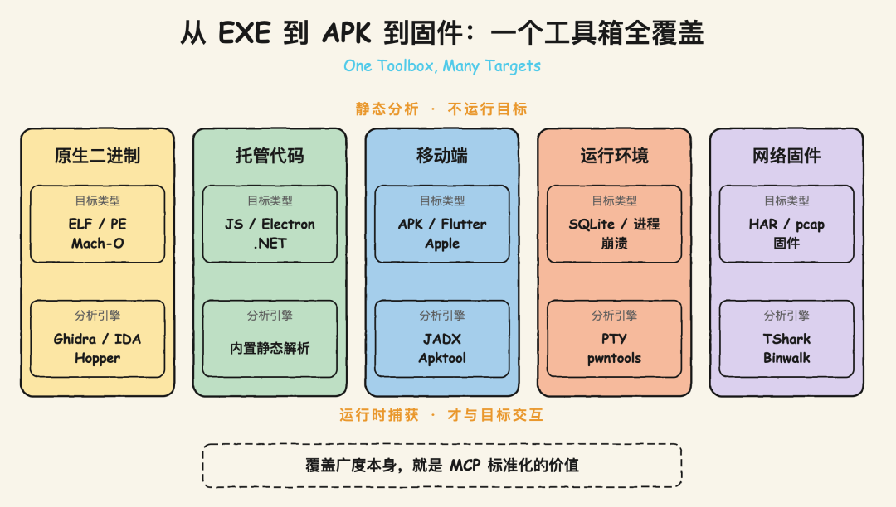
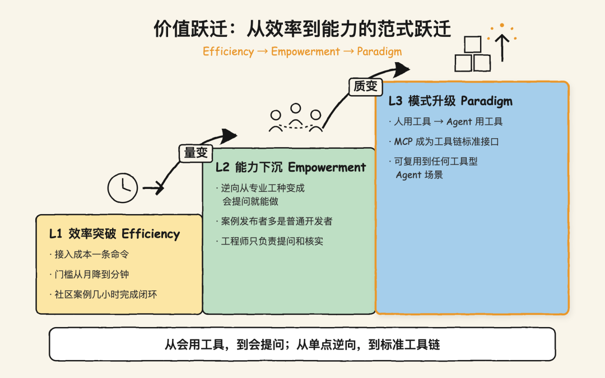

# 📰 把逆向工程交给 Agent：一文拆解爆火的 REA 技术原理


作者：stevenzuo

>
>
> 引言 ：10 月上旬一周内，GitHub 上一个叫 REA 的项目 Star 从 1.5 万冲到 23 万+，凭什么这么火？
> ----------
>
>
>
> REA 全称 Reverse Engineer Anything——逆向一切，要啃的是计算机领域一个由来已久的硬骨头：没有源码，如何从编译好的二进制里反推出软件的实现逻辑。过去这是逆向工程师用 Ghidra、IDA、Hopper 纯手搓死磕的苦活。本文深入拆解 REA 的工作机制与架构——逆向工程从"人用工具"切换到"Agent 用工具"，究竟是如何实现的。
>
>

## 一、背景与痛点：逆向工程是件手搓的活

大家遇到的一个最常见的场景：当你刷 App 时看到别人家有个功能做得不错，想在自己的产品里复刻一个，但人家不会给你源码。这时候想搞明白这功能到底怎么实现的，就只能从编译好的程序里反推逻辑，这件事就叫**逆向工程**。它跟"破解软件"是两回事，正经用途是恶意软件分析、漏洞研究、协议理解、旧系统兼容、恢复遗失源码。

问题在于，过去这件事全靠人肉：逆向工程师手动打开 IDA、Ghidra 这些工具一点点翻。工具本身很专业，但整条流程很原始，全靠手搓：



>
>
> 💡 **痛点**：逆向的门槛不在"工具难用"，而在"每一步怎么走、走到哪一步算完"——这些全装在逆向工程师的脑子里，光会操作工具还不够，还得靠多年积累的经验。
>
>

三个问题随之而来：

|    痛点     |                      表现                      |
|-----------|----------------------------------------------|
|**工具散、门槛高**|IDA、Ghidra、Hopper、JADX 各有各的操作方式，入门要啃几个月的快捷键和概念|
| **过程黑盒**  |    一次逆向"为什么追这个 XRef、为什么进这个函数"，没有留档，别人无法复核    |
| **经验不沉淀** |        每个逆向工程师的套路是孤立的，换个目标、换个人，都要从头再来        |

说白了，逆向这活儿长期卡在两件事上：门槛高（得会熟练操作一堆专业工具），经验还带不走（全在人脑子里）。那能不能让 AI 编程助手自己来干？这正是 REA 在做的事。

## 二、三大挑战：为什么逆向一直是 Agent 的禁区

过去不是没人想让 AI 做逆向，是三个坎一直迈不过去。

### 2.1 工具不可调用 ###

编程 Agent 擅长"读代码、写代码"，但 Ghidra、Hopper 这些是 GUI 桌面软件，没有统一的编程接口。Agent 想分析一个二进制，要么没法调工具，要么得为每个工具写一套胶水代码。工具和 Agent 之间，缺一个标准接口。

### 2.2 过程不可追溯 ###

逆向的产出应该是一份"证据链"：这个函数在哪个地址、被谁调用、反编译出来是什么。但传统逆向的产出往往只有结论，没有中间证据。Agent 如果直接给结论，没人敢信；要让它给证据，得先把"发现"结构化。

### 2.3 经验不可复用 ###

一个经验丰富逆向工程师——"先搜字符串、再追 XRef、可疑点回汇编验证"——是一套方法论。这套方法论写不进工具，也没法被另一个 Agent 复用。

>
>
> **三层叠加**：工具接不上、过程没留痕、经验不沉淀，让"让 AI 做逆向"这件事，在 REA 出现之前一直停在 demo 层面。
>
>

### 2.4 问题本质：逆向不是算力问题，是编排问题 ###

这三道坎背后是同一个根子：逆向的本质，是一套**调查流程**（search → XRef → call graph → decompile → 重建），不是单次算力调用。谁把这套流程标准化、接口化，谁就能让 Agent 跑起来。REA 做的就是这个。

## 三、整体思路：把工具接成 MCP 接口



### 3.1 一句话概括 ###

>
>
> **逆向工程的本质，不是"会用工具"，而是"能调用工具并拿到带证据的结论"。**
>
>

REA 的定位很克制：它不自研反编译引擎，而是做一个 MCP（Model Context Protocol）服务器，把 Hopper、Ghidra、IDA、JADX 这些已有工具包装成 Agent 能直接调用的接口。Agent 通过 MCP 问一句"这个搜索功能怎么实现的"，REA 去查目标、追踪代码，返回**带证据的发现**，Agent 再据此解释行为、写测试、重建实现。

### 3.2 核心工作流闭环 ###



标准流程就是一条固定的调查链：**打开二进制 → 搜索字符串 → 追 XRef → 看 Call Graph → 反编译 → Agent 重建功能**。Agent 自主决定下一步搜什么字符串、追哪个 XRef、进哪个函数、何时回汇编验证。

### 3.3 一句话说清它解决了什么 ###

|  挑战  |            REA 的答案            |
|------|-------------------------------|
|工具不可调用|    MCP 标准化，把 GUI 工具接成编程接口     |
|过程不可追溯|      结果契约：每条发现都附带证据和局限说明      |
|经验不可复用|安装时注入工作流指令（skill），调查方法论变成可复用的资产|

## 四、架构拆解：四个关键设计

REA 的仓库是 TypeScript + Node.js，用 Turbo 管 monorepo，Vitest 做测试。真正值得说的是它的四层设计。

### 4.1 桥接层：一套接口，多引擎可插拔 ###

🎯 **挑战**：Hopper、Ghidra、IDA 三家反编译器，各有各的 API 和启动方式，不可能让 Agent 记三套语法。

💡 **解决方案**：`bridge/` 目录做统一桥接，把不同供应商的工具封装成一致的 MCP 工具接口。原生分析支持多 Provider 选择，用环境变量切换引擎：

```

# 用环境变量切换反编译引擎、调整启动超时REA_HOPPER_STARTUP_TIMEOUT_MS=60000REA_GHIDRA_STARTUP_TIMEOUT_MS=60000

```

>
>
> 💡 **敲重点**：桥接即扩展——Bridge as Extensibility。加一个引擎，加的是桥接实现，不是改上层接口。
>
>



### 4.2 静态与运行时分层 ###

🎯 **挑战**：不同的目标类型，分析方式完全不同。JavaScript、.NET 直接读文件就行，原生二进制要跑 Ghidra，Android 要上 JADX。

💡 **解决方案**：REA 按"静态 / 运行时"两层切。静态分析（JS、.NET、APK 解析）不运行目标、直接读文件；运行时捕获（进程行为、Frida 验证）才与目标交互。目标类型覆盖极广：

| 类别  |              目标               |           引擎            |
|-----|-------------------------------|-------------------------|
|原生二进制|       ELF / PE / Mach-O       |  Hopper / Ghidra / IDA  |
|托管代码 | JavaScript / Electron / .NET  |         内置静态解析          |
| 移动端 |Android APK / Flutter / Apple 包|  JADX + JDK / Apktool   |
|运行环境 |      SQLite / 进程行为 / 崩溃       |Node.js / PTY / pwntools |
|网络固件 |     HAR / pcap / 固件 / 信号      |TShark / Binwalk / sigrok|



### 4.3 结果契约：发现必须带证据 ###

🎯 **挑战**：Agent 给结论没用，得有证据支撑，否则不可信、不可复核。

💡 **解决方案**：所有分析结果都附带**证据和局限性说明**。Agent 拿到的不只是一个"函数是干这个的"，而是"这个函数在地址 X、被 Y 调用、反编译伪代码是 Z、结论的置信边界是 W"。这直接对标工程里的"结论可追溯"。

>
>
> 💡 **敲重点**：证据即可信——Evidence as Trust。逆向的产出不是答案，是一条能回放的证据链。
>
>

### 4.4 安装即注入： npx rea-agents setup ###

🎯 **挑战**：怎么让 Agent "学会"逆向的调查方法论，而不是只会调工具。

💡 **解决方案**：一条命令完成三件事——注册 MCP 服务器、安装工作流指令（skill）、备份现有配置：

```

npx rea-agents setup

```

setup 之后重启 Agent，它就有了逆向的调查能力。官方支持 Claude Code、Codex、Cursor、Gemini CLI、Grok Build 等，其他客户端可手动注册 MCP。这也解释了为什么它爆火：**接入成本一条命令，价值却是整套逆向工具链**。

|      决策      |              取舍理由               |
|--------------|---------------------------------|
|**不做引擎、只做桥接** |复用几十年沉淀的 Ghidra/IDA，专注解决"编排"这个真问题|
|**MCP 而非自建协议**| 借 MCP 生态，任何支持本地 MCP 的 Agent 都能用 |
|  **结果带证据**   |    Agent 时代"结论可追溯"是硬门槛，不是可选项    |

## 五、实战案例：社区已经逆向出什么了

REA 爆火的另一半原因，是社区案例足够硬核，每个都能验证"它到底能不能干活"。

### 案例 1：DX-Ball 声音算法字节级还原 ###

1996 年的老弹球游戏，从编译好的 x86 二进制里抠出声音左右声道定位函数，用 C 重写后跑了 3205 个原始测试用例全部通过，63 个编译字节与原版完全一致。这是官方最硬核的 showcase，证明了"不是看着像，是真的对上了"。

### 案例 2：Notion 剪贴板调用链全追踪 ###

从 Electron 渲染进程的剪贴板 API 出发，穿过 preload 脚本、IPC 通道，一路追到主进程，把 Notion 富文本剪贴板的完整数据格式和消息 payload 全部扒了出来。Electron 三层架构的逆向，社区里最经典的案例之一。

### 案例 3：东方 TH04 弹幕角度计算恢复 ###

PC-98 平台上的 16 位老游戏，从 16 位汇编指令里恢复了固定角度和瞄准角度两套弹幕计算逻辑，还把重建结果和历史编译器输出做了交叉验证。对 Mod 作者和老游戏保护者来说价值很大。

### 案例 4：Sony Sound Connect 独立 Android App ###

社区开发者连接 Samsung S24 Ultra，让 Codex 用 REA 分析 Sony 官方 App，逆向出 Wind Noise Reduction 功能的实现链路，做了一个独立 App——打开就能直接开启降噪。这是目前最接近"真实商业 App 功能提取"的案例。

### 案例 5：射击游戏 99% 函数还原为 C++ ###

十几个 Agent 并行工作，把一款商业射击游戏 99% 的函数还原成了 C++，其中 83% 编译后和原程序逐字节一致。这个案例用的不是 REA 而是 Hex-Rays 官方 MCP，但同样属于这波 AI 逆向浪潮的代表作，说明了 Agent 并行逆向的可行性。

>
>
> 另有社区案例：YuriRDev 不到 12 小时逆向自有家居 IoT 软件实现电脑控制、greco 逆向自家电视、BrOrlandi 逆向小米体脂秤并开源 dashboard。这些的共同点：**发布者都不是专业逆向工程师，而是"会提问的普通开发者"**。
>
>

## 六、效果与方法论：从"会用工具"到"会提问"

### 6.1 量化对比 ###

| 维度 |传统逆向（人用工具） |      Agent 逆向（REA）      |    变化    |
|----|-----------|-------------------------|----------|
|入门门槛|啃几个月 GUI 工具|一条 `npx rea-agents setup`|**月 → 分钟**|
|分析过程| 在脑子里，无留档  |       每条发现带证据可回放        | **从无到有** |
|经验复用|   靠人传帮带   |      工作流指令 + 社区案例       | **资产化**  |
|目标规模|   单点分析    |      可整体丢几十 MB 目标       | **量级跃升** |

### 6.2 价值跃迁三重突破 ###



>
>
> ⚡ **量化提效**：接入成本从"啃几个月工具"压到"一条命令"，社区案例从几小时到十几小时完成一个完整逆向闭环。  
> 📥 **能力下沉**：逆向从专业工种，下沉到"会提问的工程师"——案例发布者里大量是普通开发者。  
> 📚 **模式升级**：这件事真正的趋势意义，是"人提出需求、Agent 用工具"开始覆盖逆向这个原本最依赖人工经验的领域。
>
>

### 6.3 方法论提炼 ###

### 6.3.1 桥接即扩展：Bridge as Extensibility ###

REA 不重写引擎，只做统一桥接。加一个反编译器是加桥接实现，上层接口不动。这比"自研一套逆向引擎"聪明得多——它站在 Ghidra、IDA 几十年沉淀的肩膀上，专注解决"编排"这个真正没被解决过的问题。

### 6.3.2 证据即可信：Evidence as Trust ###

Agent 时代的逆向产出不是"一个答案"，而是"一条能回放的证据链"。函数在哪、被谁调用、伪代码是什么、边界在哪，缺一样都不算可信。

### 6.3.3 提问即编排：Prompt as Orchestration ###

逆向的调查流程（搜字符串 → 追 XRef → 反编译 → 重建）被固化进工作流指令，Agent 自主决定下一步，工程师只负责提问和核实。

## 七、边界与局限：REA 现在还不能做什么

当然，REA 并不是"逆向一切"的法宝。

### 不适合的场景 ###

* **复杂混淆、反调试、虚拟机壳：**

  遇到商业级加固，Agent 仍会卡住，这层是反编译引擎自身的边界，不是桥接能解决的。

* **内核级逻辑、驱动逆向：**

  需要的是更深层的动态调试能力，当前 REA 的静态优先路线覆盖不全。

* **需要法律授权的目标：**

  REA 明确声明只用于合法研究、教育、互操作性、软件保存，分析你拥有或被授权检查的软件。社区案例（逆向自家电视、自家体脂秤）都守着这条红线。

### 核心判断 ###

**场景是"分析一个有权检查的目标、想搞清功能怎么实现"，用 REA 很合适；场景是"破商业加固、碰 DRM"，REA 既做不了，也不该做。**

## 结语

REA 爆火这件事，真正的信号不在"逆向工程火了"，而在它印证了一个已经发生多次的趋势：**Agent 的能力边界，正在从"读代码、写代码"，扩到"调用任何工具"**。逆向只是最新被"Agent 化"的一个领域，前面有代码生成，后面还会有更多。

它的价值不在技术有多新——桥接、MCP、结果契约，都是成熟的东西——而在它把这几样成熟的东西组合起来，回答了那个一直没被回答好的问题：逆向这套高度依赖经验的流程，怎么才能被标准化、接口化、交给 Agent。

>
>
> **逆向工程的门槛，从"会用工具"降到了"会提问"。这一降，降掉的不是门槛本身，而是一整个工种的经验壁垒。**
>
>


