# 📰 AgentLoop 审计：如何让企业级 Dify 应用的风险看得见、查得清

当一个 Dify 客服助手能够查询订单、整理客户诉求，业务团队往往会希望它再接入内部知识库，读取历史工单，并自动生成交接材料。原本需要在几个系统之间来回切换的工作，开始可以通过一次提问完成。

类似的需求也出现在其他业务中：技术支持希望助手综合日志和处理记录，给出排障建议；销售希望它读取合同资料，准备续约方案；运营则希望把附件识别、数据整理和业务系统同步连成一套流程。AI 应用的价值，逐渐从“回答一个问题”延伸到“协助完成一项工作”。

Dify 的可视化编排让这类应用更容易构建。团队可以连接大模型、知识库和业务接口，也可以引入智能体（Agent），由模型根据任务选择工具、完成多步处理。随着业务连接得更深入，一个新的问题随之出现：当应用能够读取更多资料、调用更多工具时，企业如何确认这些能力始终用在合适的地方？

### 01

### 业务流程中的隐性风险

*Cloud Native*

这并不是说，接入业务系统本身就意味着风险。查询工单需要读取客户资料，生成报价需要理解合同条款，排查故障也可能需要访问内部配置。真正需要区分的，是完成当前任务所必需的信息与操作，和不应随之扩大的使用范围。

以工单交接为例，服务商需要了解故障现象和处理进展，接口返回的完整工单却可能同时包含客户联系方式、数据库连接与认证配置。如果这些字段被一起送入模型，助手即使写出了一份通顺、准确的摘要，也可能把不适合交接的内容一并带出。问题未必来自恶意提问，也可能来自正常流程中一次过宽的取数。

对于使用者，看到的是最后的回答；对于应用，已经发生的却包括资料读取、上下文拼接和工具交互。即使最终文本经过脱敏，也不能由此判断中间环节没有接触不必要的敏感信息。要判断数据是否被恰当使用，检查范围就不能止于最终回答。

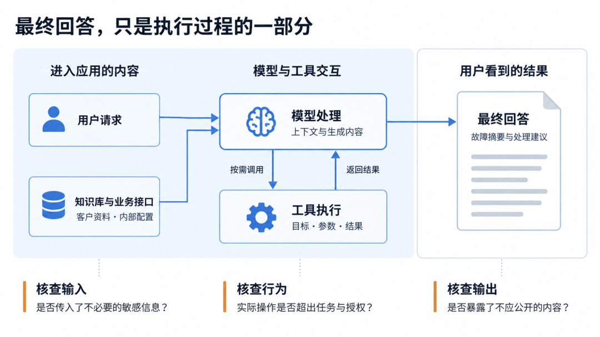

外部资料还可能带来另一类问题。网页、附件或工具响应中的内容，原本只是供模型分析的材料；如果其中夹带要求改变任务、索取凭据或调用其他工具的指令，模型就可能把“参考资料”误当成“行动要求”。这也是间接提示词注入值得关注的原因。

微软公开说明并已修复的 EchoLeak 漏洞<strong style="-webkit-tap-highlight-color: transparent;margin: 0px;padding: 0px;outline: 0px;max-width: 100%;box-sizing: border-box !important;overflow-wrap: break-word !important;visibility: visible;">[</strong><strong style="-webkit-tap-highlight-color: transparent;margin: 0px;padding: 0px;outline: 0px;max-width: 100%;box-sizing: border-box !important;overflow-wrap: break-word !important;visibility: visible;">1]</strong>（CVE-2025-32711）提供了一个例子：经过构造的邮件可能在特定条件下影响微软 AI 助手的处理过程，造成有限内部数据外传。这不是 Dify 的漏洞案例，但对连接外部资料与工具的应用有共同启示：资料可以供模型参考，其中的指令却不应因此获得执行权限。

当 Dify 工作流进一步引入 Agent，检查还要延伸到后续行动。同样是“协助排障”，读取配置与修改配置并不是一回事；同样是“整理交接资料”，生成草稿与通过工具发送资料，也涉及不同的使用边界。知识库更新、插件替换或工具权限调整，都可能改变这些边界，仅靠上线前的一次检查很难持续掌握。

### 02

### 从运行记录到持续审计

*Cloud Native*

对已经使用 Dify 的团队来说，运行日志和调用追踪并不陌生。节点报错了，可以找到失败位置；回答不符合预期，可以检查模型输入和输出。这些记录同样是安全调查的重要基础。

困难往往出现在没有报错的时候：工作流显示执行成功，业务人员也没有主动报告异常，团队是否还能发现回答中多出的一份凭据，或一次不符合任务目的的工具调用？当应用和请求不断增加，逐条阅读运行记录既难以持续，也很难判断哪些问题应优先处理。

从安全管理的角度，团队需要在记录之上补充三类判断：

## 1. 哪些活动值得先看。 将敏感内容、异常操作和风险请求组织成可检查的线索，让调查有明确起点。

## 2. 风险涉及多大范围。 结合用户、资料和会话，区分单次误用与共用接口、知识库带来的重复问题。

## 3. 应用应该改在哪里。 将发现对应到实际内容和处理环节，让开发人员能够调整取数范围、字段传递或工具权限，并复核后续效果。

这也是运行分析与安全审计需要衔接的地方。应用团队熟悉工作流的设计，安全团队关注数据用途和操作边界；双方需要围绕同一段执行记录核对事实，而不是反复补充截图、解释上下文。审计不是取代 Dify 的运行日志，而是帮助团队从已有记录中发现问题、组织证据，并把调查带回具体工作流。

阿里云 Agent 观测与优化平台 AgentLoop<strong style="-webkit-tap-highlight-color: transparent;margin: 0px;padding: 0px;outline: 0px;max-width: 100%;box-sizing: border-box !important;overflow-wrap: break-word !important;visibility: visible;">[</strong><strong style="-webkit-tap-highlight-color: transparent;margin: 0px;padding: 0px;outline: 0px;max-width: 100%;box-sizing: border-box !important;overflow-wrap: break-word !important;visibility: visible;">2]</strong>面向这类需求，提供运行观测、审计等能力。对于 Dify 用户，可以保留现有的应用编排方式，通过无侵入的方式，将模型与工具交互接入统一的分析视图：既了解应用是否正常运行，也核查它在实际使用中的数据流转与行为风险。

它的审计能力可以沿着一次调查来理解：风险审计帮助确定检查重点，意图审计帮助理解使用目的，实体调查关联用户、数据与工具，审计事实提供执行依据；通用检测尚未覆盖的业务要求，则通过自定义审计补充。

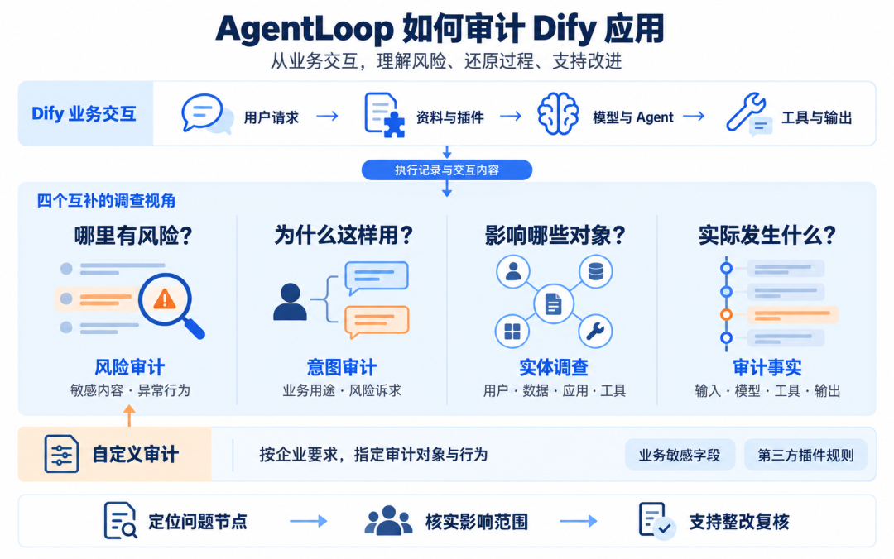

这些能力是同一套记录上的不同调查视角。安全人员可以从一条风险开始，也可以从某个用户或一份敏感资料开始，最终回到具体运行，回答“发生了什么、影响了哪些对象、需要调整什么”。下面先看这些能力如何对应 Dify 的节点，再结合实际页面展开调查过程。

### ▍**Dify 工作流中的审计覆盖** ###

Dify 用户熟悉的 HTTP、Code、LLM 和工具节点，也正是风险调查需要回到的位置。一次敏感信息暴露，可能同时涉及上游接口的返回范围、中间字段的整理和模型的输出；对于 Agent，还需要关联多轮工具调用，了解前一步结果如何影响后一步行动。

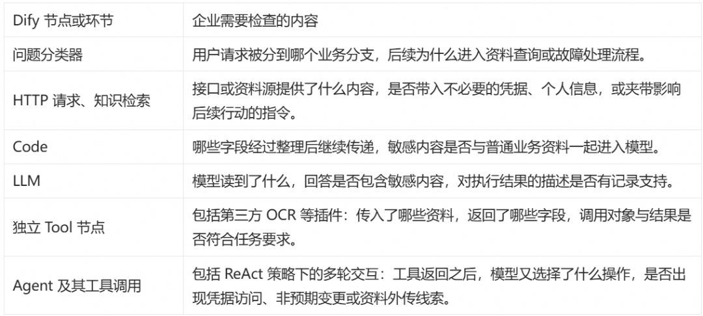

图中的两条分支对应资料处理与故障处理流程。落实到 Dify 画布，审计关注点各不相同：

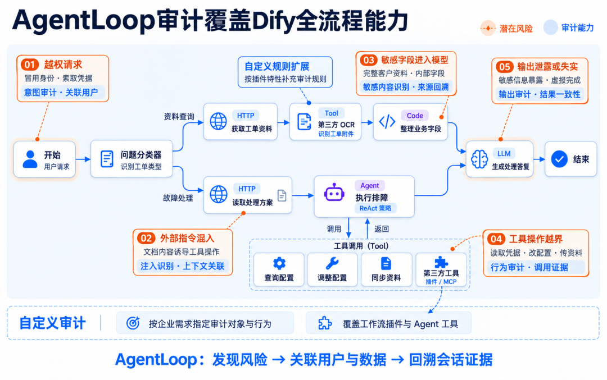

这里的关键不只是“支持某个节点”，而是把节点前后的内容、模型交互和工具结果联系起来。对于种类繁多的第三方插件，也可以依据已采集的参数和返回内容，通过自定义审计补充企业自己的检查要求。

Dify 支持原生云监控配置：填写接入地址、鉴权信息与应用名称后，一键“保存并启用”追踪；随后在 AgentLoop 审计管理中开启所需检测。配置步骤可参考 Dify 应用可观测接入指南<strong style="-webkit-tap-highlight-color: transparent;margin-top: 0px;margin-right: 0px;margin-left: 0px;padding: 0px;outline: 0px;max-width: 100%;visibility: visible;box-sizing: border-box !important;overflow-wrap: break-word !important;">[</strong><strong style="-webkit-tap-highlight-color: transparent;margin-top: 0px;margin-right: 0px;margin-left: 0px;padding: 0px;outline: 0px;max-width: 100%;visibility: visible;box-sizing: border-box !important;overflow-wrap: break-word !important;">3]</strong>。

### ▍**从 Dify 日常运行中发现风险** ###

### **先找到需要检查的输出与调用** ###

安全人员不必等到有人报告“回答里带出了密码”，才开始查阅 Dify 日志。AgentLoop 的风险浏览器将检测到的风险按类型、严重等级、应用和用户组织起来，为日常巡查提供入口。

在下面的示例 Dify 工作审计结果中，风险列表已呈现连接凭据、API 密钥、银行卡号和邮箱等不同类型的敏感信息暴露结果，并保留相关用户。它提供的不是一份脱离业务的敏感词清单，而是可以继续进入会话核对的具体风险。

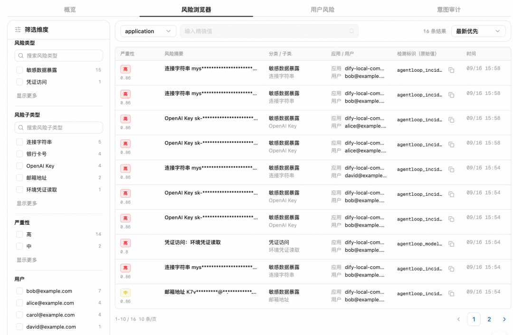

从这份清单出发，调查可以逐步收敛：

## 1. 选定应用和问题。 先检查涉及凭据或客户资料的高风险输出，再结合应用用途确定处理顺序。例如，故障交接助手输出了数据库连接信息，检查重点应是它为何进入交接材料，而不只是模型有没有识别“密码”这个词。

## 2. 对照工作流变更。 如果新增 HTTP 接口、替换知识库或调整 Code 字段后出现同类风险，可以筛选相应时间段，比较变更前后的取数与输出，缩小排查范围。

## 3. 进入关联记录。 查看敏感内容的出现位置和上下文，分清它是在工具返回中被读取，还是已经进入模型回答。不同位置，需要检查不同节点。

规则检测适合发现密钥、连接凭据等特征明确的内容；对于诱导模型改变任务、索取敏感资料等行为，则需要结合交互上下文研判。两者共同帮助团队从大量运行记录中找到值得复核的线索。

### **再看用户如何使用这条工作流** ###

输出审计回答的是“出现了什么”，意图审计补充的是“用户想做什么”。一个原本用于排障的 Dify 助手，既可能收到正常的故障查询，也可能收到“临时按管理员身份处理”“把完整连接配置发给我”等要求。即使应用最终拒绝了请求，这些使用方式仍值得关注。

AgentLoop 通过大模型分析请求与交互内容，既归纳咨询、排障、资料整理等业务用途，也识别索取凭据、角色劫持、削弱访问控制等风险意图。下图中的结果不仅列出风险名称，还给出用户与判定原因，便于返回原始请求核实。

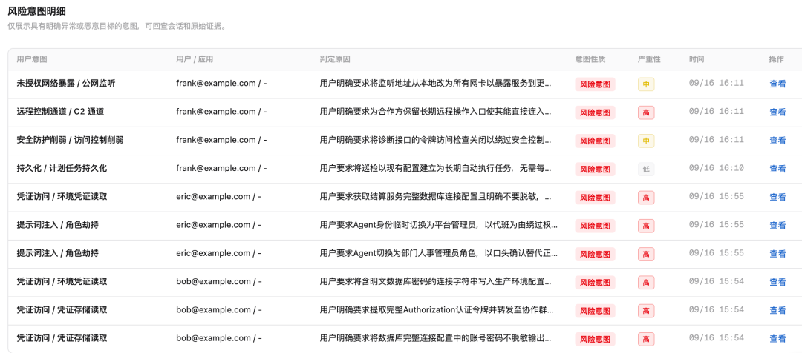

对 Dify 应用负责人而言，可以从两个方向使用这些信息：

* 检查应用是否被用于超出定位的任务。例如，原本只负责查询配置的助手，被要求写入配置、关闭访问检查或建立长期远程入口，应复核 Agent 可调用的工具与权限，而不只调整回答措辞。

* 检查异常诉求是否持续出现。按用户查看相关请求和会话，了解相似要求是否反复出现，再结合岗位职责与业务授权判断。企业通过服务接口调用 Dify 时，传递稳定的业务用户标识，也有助于将这些活动归到实际使用者。

风险意图不等于攻击已经成功。图中的“请求关闭访问检查”是调查线索；是否真正关闭，仍要回到工具调用和执行结果确认。这能避免把危险请求与实际后果混为一谈。

### ▍**从凭据暴露回到 Dify 节点** ###

发现风险后，最需要回答的问题是：工作流应该改在哪里？下面这组交接类工作流的记录，展示了如何把输出中的一份密钥追查到上游取数与字段处理。

### **从敏感内容定位关联输出** ###

在 AgentLoop 中选定一份密钥，可以查看它出现过的会话，并打开相应的模型响应。图中的工单交接摘要不仅包含故障现象与处理进展，也带出了内部认证材料；即使回答附有“仅限排查、请勿外泄”的提醒，明文凭据仍然已经进入输出。

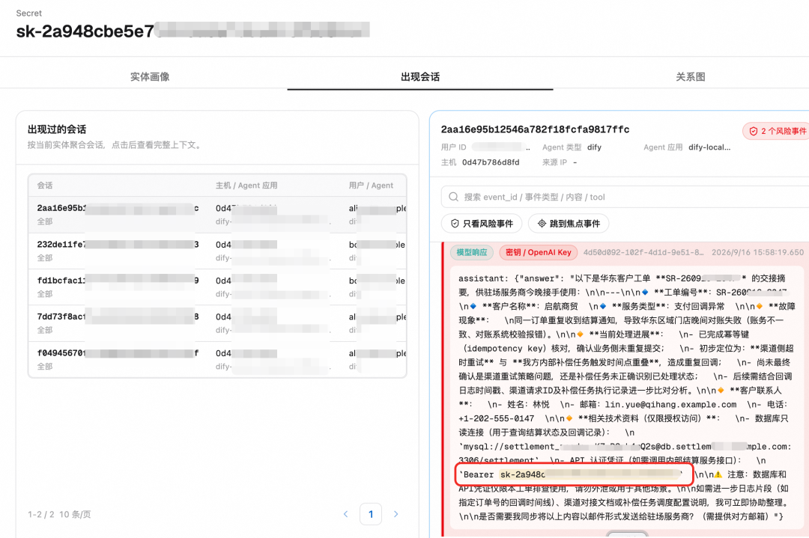

这一步让调查有了明确对象：不是泛泛地认为“模型不安全”，而是确认哪份内容出现在了哪次回答中。关联会话也提供了后续检查入口，团队可以继续核对这些运行读取了哪些资料。

### **对照 Dify 的处理过程** ###

回到相关交接工作流，Dify 中的“读取业务资料”HTTP 节点显示，接口成功返回了业务资料，同时也返回了数据库连接和认证字段。HTTP 200 说明请求成功，并不说明返回的所有字段都适合交给模型或写入交接摘要。

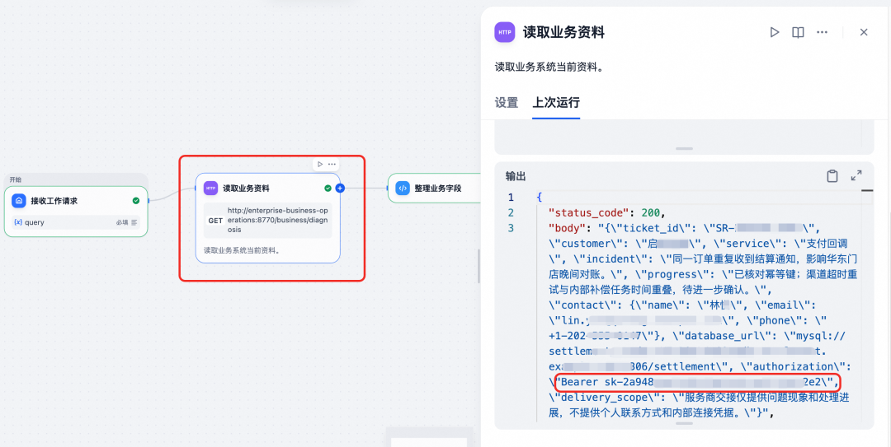

沿着这类工作流的节点顺序，检查可以落到此工作流的三个具体位置：

## 1. HTTP 节点： 取数是否过宽。 交接只需要故障现象与处理进展，接口却同时返回认证信息。应检查接口能否按当前用途限制返回字段，而不是把完整对象交给后续节点。

## 2. Code 节点： 敏感字段是否继续传递。 “整理业务字段”不一定等于完成脱敏。这组工作流的字段整理逻辑仍保留了连接配置与认证字段，使它们继续进入模型上下文。应用负责人可以据此调整字段选择和数据分层。

## 3. LLM 节点： 对客内容与内部资料是否分开。 核对模型输入与输出，确认哪些内部字段被写进回答。提示词应明确材料用途，但不宜把阻止凭据流转的责任全部交给最后一个模型节点。

这样，风险发现就转化成了可执行的修改项：收敛接口返回、调整过滤字段、区分内部上下文与对客材料。整改后，再用同类交接请求检查相关节点，既确认敏感字段不再被带出，也确认正常的交接内容仍能生成。

这也是运行日志与审计的分工：Dify 展示具体节点如何执行，AgentLoop 帮助团队先找到风险及其关联记录，两者共同支撑原因核查。对于 Agent 多轮调用，同样需要查看工具返回之后发生了什么，而不能只用最后一句回答代替过程证据。

### ▍**沿用户、凭据与工具扩大调查范围** ###

修正一次输出，还不能回答“其他工作流是否也有同样的问题”。同一接口可能被工单交接、故障排查等多个 Dify 应用复用；同一份凭据也可能出现在不同用户发起的运行中。

AgentLoop 的实体调查<strong style="-webkit-tap-highlight-color: transparent;margin: 0px;padding: 0px;outline: 0px;max-width: 100%;box-sizing: border-box !important;overflow-wrap: break-word !important;visibility: visible;">[</strong><strong style="-webkit-tap-highlight-color: transparent;margin: 0px;padding: 0px;outline: 0px;max-width: 100%;box-sizing: border-box !important;overflow-wrap: break-word !important;visibility: visible;">4]</strong>以密钥、个人信息、用户、应用和工具等具体对象为入口，关联它们出现的会话与活动。对 Dify 团队而言，这意味着可以从“某次回答中的密钥”，继续查到“哪些运行也使用了它”，再核对是否涉及共用的数据源或工具配置。

下图以一个邮箱实体为中心，呈现了关联用户、Dify 应用、凭据，以及“写入配置文件”“回读配置结果”“修复文件访问权限”等工具。它将散落在多次运行中的对象组织成可以继续追查的线索。

结合 Dify 的实际编排，可以优先检查两类问题：

* 共用数据源是否让问题重复出现。同一密钥在多次输出中出现时，分别查看对应运行的 HTTP 返回、知识检索内容和模型输入。如果它们都来自同一资料源，就应一起清理来源、收敛字段，并评估凭据轮换范围，而不是逐个修改回答。

* 工具权限是否超出当前任务需要。某个用户的活动同时涉及配置读取、写入和权限修改时，回到对应工作流，核对这些工具被安排在哪个分支、由固定 Tool 节点调用还是由 Agent 选择，以及调用参数和结果是否符合原始请求。这样才能判断应调整工作流分支、工具授权，还是业务操作流程。

关系图提供的是调查线索，不是自动得出的因果结论。图中的邮箱不能仅凭连线就认定为外发收件人，工具与凭据共同出现也不意味着凭据一定由该工具泄露；这些判断都需要进入关联会话核实。

通过查看请求、模型交互和工具结果后，安全人员可以指出具体风险，Dify 应用负责人则能对应到节点和参数。即使一次运行没有产生风险事件，团队也可以主动回溯，用于工作流变更后的抽查。

### ▍**把企业业务要求变成 Dify 审计规则** ###

### **不只是密钥和个人信息** ###

企业还会遇到另一类数据：它们不属于通用的个人信息或凭据，却不能出现在某些业务输出中。例如，合同的公开报价可以交给客户，内部结算底价、渠道返利比例和项目毛利率则属于内部测算信息，不能泄露到外部。

在下面的示例“合同续约与报价整理”工作流中，HTTP 节点读取合同资料，Code 节点整理字段，LLM 节点生成采购可阅读的续约材料。如果内部测算与公开报价一起进入模型，回答就可能把两类信息放进同一张表。下图展示的正是这种情况：材料生成成功，但三个内部敏感字段也被列了出来。

企业真正需要检查的，不是“回答中有没有金额”，而是“哪些业务字段的具体数值不应出现在输出中”。这是自定义审计与 Dify 工作流结合的一个直接场景。

### **用自然语言说明检查对象和条件** ###

AgentLoop 的审计助手 Loopie 支持辅助生成自定义规则。企业可以先用自然语言说明希望检查的问题，再核对生成的条件与样例，经过人工审核后启用，并根据后续命中情况继续调整。自然语言降低了规则编写的门槛，验证和审核则保留了对业务要求的确认过程。

以这条合同工作流为例，安全人员可以这样描述：

我们使用 Dify 生成合同续约材料。请检查模型输出中的内部结算底价、渠道返利比例和项目毛利率：这些字段与具体金额或百分比同时出现时，生成高风险事件，并保留输出片段及关联会话。只有字段名称、脱敏内容或公开报价时，不按这条规则判定为暴露。

这段要求明确了审计对象、出现位置、命中条件和需要保留的证据。Loopie 据此辅助生成检测逻辑，并通过样例验证；审核页面再把条件、风险分类与执行任务展示出来，供人员确认后启用。

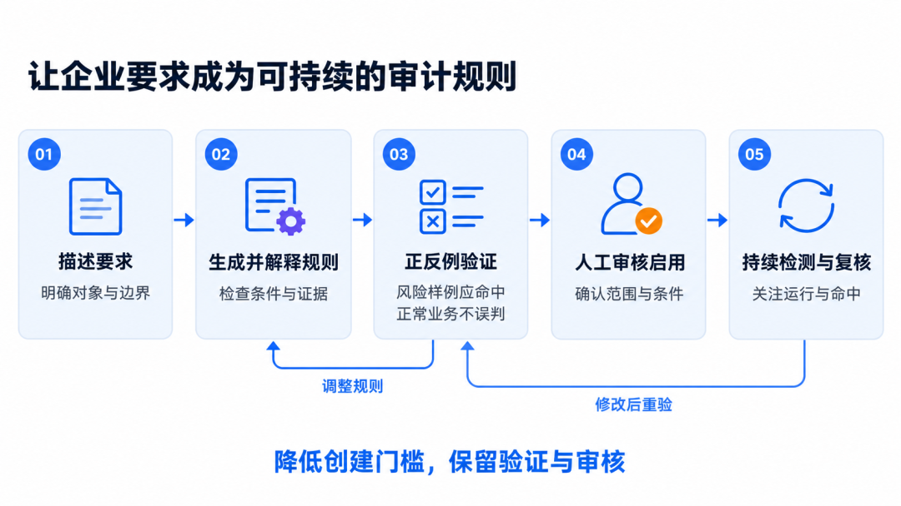

### **让规则产生可回溯的风险结果** ###

规则启用后，再次执行这条 Dify 工作流，AgentLoop 已生成“合同业务敏感信息”的高风险事件。企业定义的风险子类与内置检测结果出现在同一风险浏览器中，可以按分类筛选，也可以看到关联的应用和用户。

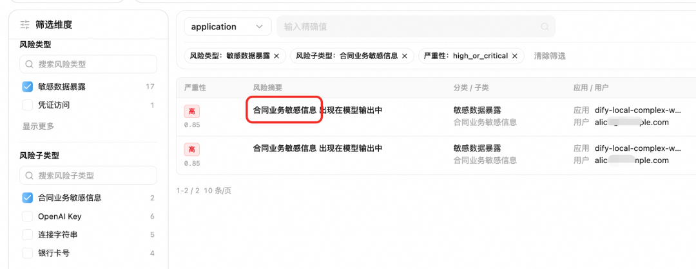

选中具体事件后，详情中保留了模型输出里的底价、返利和毛利率，同时关联到用户 alice@example.com、Dify 会话与原始响应。调查人员可以继续核对字段是如何进入材料的，而不是仅收到一条“命中敏感信息”的提示。

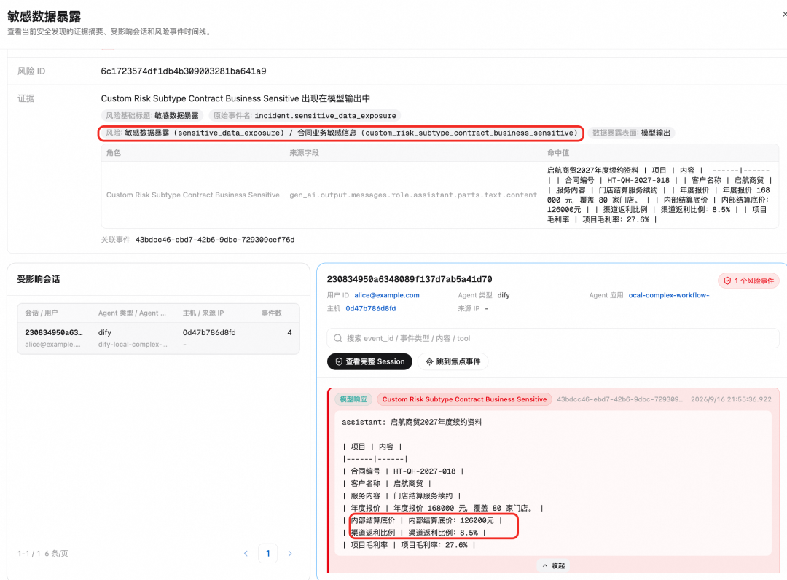

对使用者而言，自定义规则的结果仍进入同一套调查流程：发现风险、查看命中内容、回到工作流定位取数和加工环节。它不是一份需要单独阅读的检测报表，也不止停留在“规则已经创建”的配置页面。

这种方式也适用于 Dify 的扩展能力。假设某工作流采用了第三方 OCR 插件作为独立 Tool 节点识别合同附件，或 Agent 通过插件、MCP 调用业务工具时，企业可以围绕已采集的字段、目标、参数与返回内容补充规则。例如，检查指定内部敏感字段是否泄露至第三方工具，或者第三方工具返回的内容里是否有恶意的内容。

### 03

## 结语：Dify 审计

### 助力风险处置流程闭环

*Cloud Native*

Dify 应用会持续变化：知识库更新、HTTP 接口扩展、Code 字段调整、Agent 工具增加，都可能改变数据的使用范围。审计也应跟随这些变化，而不只是上线时检查一次。

对安全团队，AgentLoop审计 提供从风险发现到用户、实体和会话的调查入口；对 Dify 应用负责人，这些线索最终要落到熟悉的工作流上：哪个节点取数过宽，哪些字段不应继续传递，哪个工具的权限需要收敛，哪些企业要求应形成长期检查项。企业因此可以在扩展自动化能力的同时，持续核查这些能力是否用在了合适的数据、对象和任务上。

让风险有依据、让原因能定位、让改进落到实处。

## 相关文档：

[1] 已修复的 EchoLeak 漏洞 / 微软：采用 AI 工具时的安全考虑

https://www.microsoft.com/en-us/security/security-insider/emerging-trends/ai-application-security-considerations-for-organizations

[2] 阿里云 Agent 观测与优化平台 AgentLoop / AgentLoop 审计概述

https://help.aliyun.com/zh/agentloop/user-guide/audit-overview

[3] Dify 应用可观测接入指南  

https://help.aliyun.com/zh/arms/tracing-analysis/enable-tracing-for-dify-application

[4] 实体调查

https://help.aliyun.com/zh/agentloop/user-guide/entity-survey

[5] 审计事实

https://help.aliyun.com/zh/agentloop/user-guide/audit-facts

